# HTMLとは


## HTMLとは
HTMLは、Webページの文書の構造（どこに何があり、それが何であるか）を記述するための言語です。  
ブラウザ上のどこになにを表示するかを記述出来ます。  
(例えばここに見出しがある、ここにボタンがある、ここにテキストボックスがある、といった内容を記述します。)     
色や大きさなどの見た目は、後述するCSSが担当します。  
ブラウザはHTML言語で書かれた文字列を解析し、それに従って画面を描画します。   

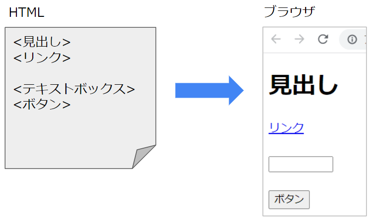  

このように文書の構造や意味を表現する為の言語を**マークアップ言語**といいます。  

## HTMLの基本的な文法  
マークアップとは、文字列に意味を持つマークをつけることです。  
マークを付けることで、ブラウザがテキストの意味を解釈出来ます。  
HTMLでは`<>`と`</>`で囲む事で文字列をマークアップします。  

まずは実際のHTMLの例を見てみましょう。  
```
<!DOCTYPE html> 
<html>
  <head>
    <title>タイトルです</title>
  </head>
  <body>
    <h1>見出しです</h1>
    <a href="http://example.com">リンク</a>
    <button>ボタン</button>
  </body>
</html>
```
これをブラウザが描画すると以下のような画面になります。

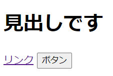  


`<>～</>`の部分をタグと呼びます。  
`<>`の中の文字列は、そのタグが何を表しているかをブラウザに伝えています。    
例えば`<button>ボタン</button>`の箇所は、ここにボタンの情報が記述されていることをブラウザに伝えています。  
この記述があると、ブラウザは画面上にクリック可能なボタンを描画します。  

タグの中に記載できる文字(`button`など)と、そのタグを画面にどのように描画するべきか(クリック可能なボタンを描画するべき など)は、HTMLの仕様で定義されています。     

基本的に、タグには開始タグと終了タグが必要です。（終了タグを持たない例外は[後述](#空要素終了タグを持たない要素)）  
前述の例の場合、`<button>`(タグ内の文字列に/をつけないもの)が開始タグで、`</button>`(タグ内の文字列に/をつけたもの)が終了タグとなります。  

開始タグと終了タグで囲まれた範囲が、タグ内で指定された文字(例の場合は`button`)についての情報が書かれている範囲となります。  
タグの中に別のタグを入れ子で記述することも可能です。  

例）`body`というタグ内に`button`というタグが記述されている。  
```
  <body>
    <button>ボタン</button>
  </body>
```
詳しい文法については後述します。  
HTMLはこのようにタグを組み合わせて文書を記述していきます。  

HTML言語で書かれた文字列を保存したテキストファイルは、HTMLファイルと呼ばれます。  
ファイルの拡張子は.htmlとすることが一般的です。  

以下タグを含めたHTMLの基本的な文法や名称について説明していきます。 

### 要素

前述の通り、HTMLは、`<></>`で囲まれた**タグ**を組み合わせて記述します。  
例）  
```
<h1>見出しです</h1>
```
タグのそれぞれの部分には名称があります。  

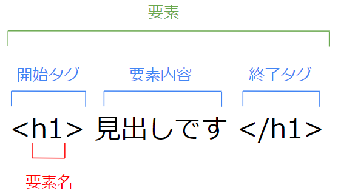

- 開始タグ  
左の`<>`で囲まれた部分  

- 終了タグ  
右の`</>`で囲まれた部分 


- 要素名  
`<>`の中に書かれている名前（例だと`h1`）  
そのタグが何であるかを表す。  

- 要素内容  
タグに囲まれた部分

- 要素  
開始タグ～終了タグまでのまとまり


要素名に指定できる文字は仕様で[定義](https://html.spec.whatwg.org/#semantics)されており、それぞれ意味が決まっています。  

例えばタグ内の文字が`h1`の場合、タグで囲まれた部分の文字列が最上位の見出しである、という意味になります。  
ブラウザは既定では、`h1`の文字列を大きな太字で表示します。  

ブラウザはこの仕様にしたがって画面を描画します。  
実際に`h1`タグをブラウザがどう描画するか見てみましょう。  
```
<h1>見出しサンプル</h1>
```
上記のタグをブラウザは以下のように描画します。  


別の例として、タグ内の文字が`a`の場合、他のページ（同じサイト内のページも含む）へのリンクを表示する、という意味になります。  
この場合、ブラウザは指定されたURLにページ遷移する為のリンクを表示します。  
```
<a href='http://google.com'>外部リンクサンプル</a>
```
上記のタグをブラウザは以下のように描画します。  

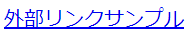

他にも様々な意味のタグが存在します。  
開発者は色々なタグを組合せてHTMLの文字列を作成し、どのような画面を描画するべきかをブラウザに伝えます。  

※要素は改行して記述する事も可能です。  
```html
<a href='http://google.com'>
  外部リンクサンプル
</a>
```

### 属性

ここで、`a`というタグ名の横に`href`というものが記載されています。  
これは**属性**とよばれ、タグに情報を付加する為に利用されます。  

属性の種類と意味もHTMLの仕様で定義されています。  
例えば`href`はリンクがクリックされた場合の遷移先URLを表します。  

属性にはすべてのタグに指定できる共通の属性と、特定のタグでだけ指定できる属性があります。  

属性は`属性名=属性値`という形式で記述され、複数指定可能です。  
属性の各部分の名称は以下になります。  

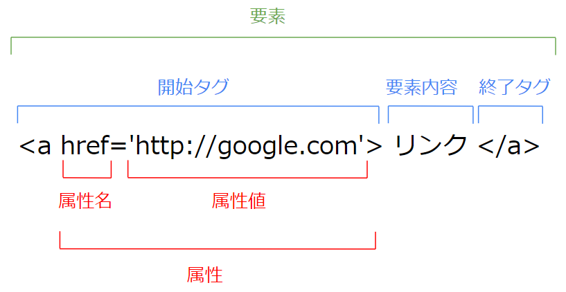


### よく使われる要素
特によく使われる要素（タグ）をいくつか紹介します。  

- div  
   div要素は特別な意味を持たず、画面上には何も描画しません。  
   主に要素をグルーピングする目的で利用されます。  
   
   例えば以下のようにdiv内に要素をまとめることで、div内の要素全てにだけ特定のスタイルを適用する、などが柔軟に行えます。  
   (スタイルは見た目を定義するための記述です。[CSSについての記事](1_5.CSSとは.md)で詳しく説明します。)  
   
   ```html
   <div id="nameBlock" style="color:blue">
     <h3>基本情報</h3>
     <span>山田太郎</span>
     <span>20歳</span>
   </div>
   
   <div id="addressBlock" style="color:red">
     <h3>住所</h3>
     <span>都道府県：北海道</span>
   </div>
   ```

   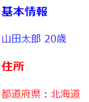  

   またdivは既定で**ブロック要素**として表示される要素です。  
   ブロック要素は、要素内の他要素の横幅にかかわらず、親要素の横幅いっぱいの領域を確保します。  
   その為、div要素の前後が改行された状態で表示されます。  
   ブロック要素については後ほど説明します。  

- table  
  表形式でデータを表現する為に利用します。  
   ```html
   <style>
     table, td, th { 
       border: 1px #2b2b2b solid; 
       border-collapse: collapse;
       padding: 8px;
     }
    </style>

   <table>
    <thead>
      <tr>
        <th>地域</th>
        <th>気温</th>
      </tr>
    </thead>
    <tbody>
      <tr>
        <td>札幌</td>
        <td>20°</td>
      </tr>
      <tr>
        <td>東京</td>
        <td>25°</td>
      </tr>
      <tr>
        <td>沖縄</td>
        <td>30°</td>
      </tr>
    </tbody>
   </table>
   ```
   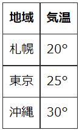  

- form、input、select  
   ユーザーが入力可能な、テキストボックスやセレクトリストを表示する為に利用します。  
   詳細は[別記事](3_1.ブラウザがHTTP通信を行うタイミング.md#フォームコントロールとは)で解説します。  

- a  
   他のページ（同じサイト内のページも含む）へのリンクを表示します。  
   ```html
   <a href='http://google.com'>外部リンクサンプル</a>
   ```
     

- span  
   divと同じく特別な意味を持たず、画面上には特に何も描画しません。  
   こちらも主に要素をグループ化するために用いられますが、divと異なり既定で**インライン要素**として表示される要素です。  
   インライン要素は、最小限の領域しか確保せず、インライン要素を続けて記載しても改行は発生しません。    
   インライン要素についても後ほど説明します。   

この他にも様々な要素が定義されています。  
[MDN HTML要素リファレンス](https://developer.mozilla.org/ja/docs/Web/HTML/Reference/Elements)


### 要素の入れ子
HTMLは要素を組合せて記述されます。  
要素は並べて記載するだけでなく、入れ子にする事も可能です。  

例
```html
<!DOCTYPE html> 
<html>
  <head>
    <title>タイトルです</title>
  </head>
  <body>
    <h1>見出しです</h1>
    <button>ボタン</button>
  </body>
</html>

```

入れ子になった要素は、以下のような階層構造になっています。  

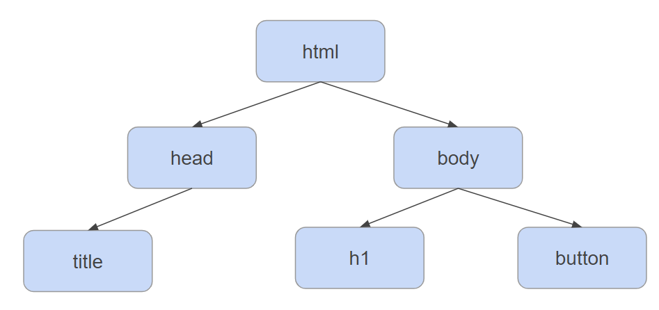

ある要素（タグ）から見て、すぐ外側の要素を**親要素**、直下の要素を**子要素**といいます。  
共通の親要素をもつ要素は**兄弟要素**といいます。  
例の場合、`head`要素から見ると`html`要素は親要素、`title`要素は子要素、`body`要素は兄弟要素となります。  


### 基本となるタグ（html・head・body）
HTMLを書く際に、基本となるタグがあります。  
それは一番外側の`<html>`要素と、ヘッダー情報を表す`<head>`、コンテンツ情報を表す`<body>`要素です。[^1]   

[^1]: 仕様上はこれらのタグを省略してもよいことになっており、省略してもブラウザが自動的に補って解釈します。  
ただしHTMLの構造が分かりやすくなるため、省略せずに書くのが一般的です。

```html
<!DOCTYPE html> 
<html>
  <head>
    <!-- ヘッダー情報-->
    <!-- 参照するファイルや言語設定などのメタ情報を記載する。 -->
    <!-- ここには画面上に描画する要素は記載しない。 -->
  </head>
  <body>
     <!-- コンテンツ情報 -->
     <!-- ここに記述した要素が画面上に描画される。 -->
  </body>
</html>
```


### DOCTYPE
HTMLは先頭行に`<!DOCTYPE>`を記述します。  

DOCTYPEを書くと、ブラウザは現在の仕様に沿った**標準モード**で画面を描画します。  
書かないと、古いブラウザの（仕様に沿わない）挙動を再現する**互換モード**で描画され、見た目が崩れる原因になることがあります。  
以下の記述をしておけば問題ありません。    
`<!DOCTYPE html> `


### ヘッダーとボディ
head・bodyタグの役割は以下になります。  

- `<head>`  
HTML自体の情報をブラウザに伝えるための部分です。  
**ここには画面上に描画する要素は記載しません。**   
（記載すると、ブラウザが`<body>`内に移して解釈するなど、意図通りにならない原因になります。）  
メタデータや参照するCSS、JavaScript(後述)などの情報を記載します。  

- `<body>`  
画面に表示するコンテンツの情報を記述する部分です。  
**ここに画面上に描画する要素を記述します。**  


#### headタグ内に記載される要素
headタグ内には主に以下の要素を記載します。  
- `<title>`  
文書のタイトルを表します。  
タイトルはブラウザのタブに表示されます。

- `<style>`  
CSSという、HTMLのデザインを指定するための言語を記載します。  
詳しくは別記事で解説します。  

- `<link>`  
外部ファイルに定義したCSSなどの、他のリソースへのパスを記載します。  

- `<script>`  
JavaScriptを記載します。  
直接記載する場合と、JavaScriptが記載されたテキストファイルの参照先を記載する場合があります。  
`<script>`タグは`<body>`内にも記載出来ます。[^2]  

[^2]: ページ描画のパフォーマンスを上げるため、あえてbodyの末尾に`<script>`タグを記載するというテクニックもあります。  
現在は、`<head>`内で`<script src="～.js" defer></script>`のように`defer`属性を付けて読み込む方法が一般的です。（HTMLの解析を止めずにファイルを取得し、解析完了後に実行されます。）  

- `<meta>`
文字コードや画面幅などの情報を記載します。  
特に以下の文字コードの指定はほぼ必須です。  
   ```<meta charset="UTF-8">```  
  metaタグでは他にも様々な指定が可能です。 

[参考：MDNのheadタグ説明](https://developer.mozilla.org/ja/docs/Learn_web_development/Core/Structuring_content/Webpage_metadata) 


### 空要素（終了タグを持たない要素）

要素内容を持つことができない要素を空要素（void要素）といいます。  
空要素は終了タグを持たないため、終了タグは書きません。  
例えば改行を表す`br`、画像を表す`img`、`input`、`meta`、`link`などが空要素です。    
```html
<!-- 正しい書き方 -->
<br>

<!-- 要素名の後ろに/をつけて書くこともできます（意味は同じです） -->
<br/>

<!-- 誤った書き方（brには終了タグがありません） -->
<br></br>
```

なお、`<div></div>`のように中身が空なだけの要素は空要素ではないため、終了タグを省略できません。  


### コメント
HTML上のコメントは以下のように記述します。  
```<!-- コメント内容 -->```

コメントアウトされた部分はブラウザに無視されます。  
ただし、HTMLファイル上に文字列としては残ってしまいます。  
ブラウザの右クリック→「ソースを表示」で、表示中のページのHTMLを誰でも確認出来てしまうので、コメントに機密情報や個人情報を書いてはいけません。    
(コメント部分に機密情報や個人情報が書いてあり問題となった事例もあります。)    


### HTMLの仕様文書
説明してきたHTMLの仕様は、WHATWGという標準化団体により策定されています。   
策定された仕様は[HTML Living Standard](https://html.spec.whatwg.org/)という名で公開されています。  
(以前はW3Cと言う団体でも定義されていましたが、WHATWGに一本化されました。)  

仕様では、文法ルールや、タグがどのような意味か、ブラウザがタグをどのように描画するべきか、などが定義されています。  
※以前はHTML5などのバージョン毎の仕様が定義されていましたが現在はバージョンは廃止されています。  
上記の仕様書に常に最新の仕様が適用されます。  


以上でHTMLの基本的な文法についての説明を終わります。  
もう少し詳しく知りたい方は末尾の参考資料などを確認してください。  

## その他

### HTMLの基本テンプレート
言語や文字コードを指定した必要最小限の構成のテンプレートになります。  

```html
<!DOCTYPE html> 
<html lang="ja">
  <head>
    <!-- ヘッダー情報を記載 -->
    <meta charset="UTF-8">
    <meta name="viewport" content="width=device-width, initial-scale=1">
    <title>ページのタイトル</title>
  </head>
  <body>
     <!-- コンテンツ情報を記載 -->
  </body>
</html>
```

`<html>`タグの`lang`属性で言語指定を行っています。(`lang="ja"`)  
デフォルトのフォントなどに影響があります。  

`meta`タグで「charset="UTF-8"」を指定しています。  
このHTMLがどの文字コードで保存されているのか指定しており、この記述が無いと文字化けの原因となることがあります。  

`name="viewport"`の`meta`タグは、スマートフォンなどで画面幅に合わせて表示するための指定です。  
`title`タグはブラウザのタブに表示されるタイトルです。  


### CSS、JavaScript 
HTMLだけでもブラウザは画面を描画できます。  
ただHTMLだけだと、見た目が質素で動きのないWebページになってしまいます。  

その為、デザインを指定する**CSS**と、振る舞いを定義する**JavaScript**と呼ばれるものを同時に利用することが多いです。  

これらはHTMLとは別の仕様(言語)であり、異なる文法で記述されます。  
ただしお互いに関連は深く、HTMLの特定の箇所に直接CSSやJavaScriptを記載することが可能です。  
（HTMLとは別のファイルとして定義することも可能です。）  

HTML、CSS、JavaScriptの役割は以下になります。  
- HTML  
Webサイトの構造（どこに何を表示するか）を定義します。  

- CSS  
Webサイトのデザインを定義します。  

- JavaScript  
Webサイトの振る舞いを定義します。  


それぞれについては別の記事で解説します。  
[CSS](1_5.CSSとは.md)  
[JavaScript](1_6.Javascriptとは.md)  


### 外部ファイルの読み込み順  
HTMLのタグには、外部のファイル（CSS、JavaScript、画像など）を読み込むためのタグが用意されています。  
それらのタグではファイルの場所を表すURLを指定できます。 

例）画像を描画する`img`タグの場合はsrc属性で画像ファイルのURLを指定します。
```html

```

URLは絶対URLで指定する場合と相対URLで指定する場合があります。  
絶対URL、相対URLについては[別記事](1_2.URLとは.md#絶対urlと相対url)を参照してください。

ブラウザはHTMLの要素を上から解析していき、**それらのタグが出現する度にファイルを取得する為のHTTPリクエストを発行します。**

1. ブラウザがHTMLファイルを解析。

1. HTMLファイル内で外部ファイルが参照されていた場合、そのファイルのURLに対してHTTPリクエストを発行して外部ファイルを取得。  
（`<link>`、`<script src="～">`、``タグなど）

1. 取得したファイルを解析し、HTMLに適用。  

1. 後続のタグの解析を続ける。  
次の外部ファイル参照タグが出てきたら同じ処理を行う。

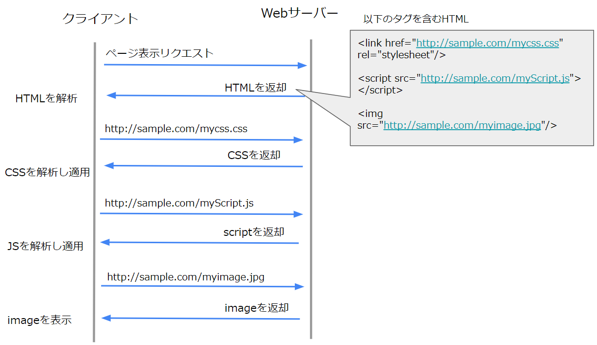

※上の図は流れを理解するための概念図です。実際のブラウザは、複数の外部ファイルを並列に取得します。  
また、外部ファイルの取得中にHTMLの解析が止まるのは、主に`defer`や`async`属性のない通常の`<script>`タグの場合です。  

外部ファイルが多くなるとHTTPリクエストを発行する回数が多くなり、画面表示のパフォーマンスに影響を与える可能性があります。  
そのため、複数のファイルを1つのファイルにまとめてファイル数を少なくするなどの工夫をすることもあります。  


### ブロックレベル要素とインライン要素
HTMLの要素は、ブラウザの既定の表示方法（CSSの`display`プロパティ）によって、ブロックレベル要素（`display: block`）とインライン要素（`display: inline`）のいずれかとして表示されるものが多くあります。  
※現在のHTMLの仕様にはこの分類自体はありません。また、表示方法はCSSで変更できます（例：`display: block`を指定するとspanもブロック要素として表示されます）。  
ここでは簡単にそれぞれの意味を説明します。  

#### ブロックレベル要素
段落など、ある程度大きなかたまり（グループ）を表現する為の要素です。  
特定の意味毎に要素をまとめる場合などに利用します。  
div、h1、p、bodyなどが代表的です。  

ブロックレベル要素のレイアウトには以下の特徴があります。  

- 横幅  
**親のブロックレベル要素の横幅全体を占有します。**  
つまり、ブロック要素の後の要素は、1段下に表示されることになります。  
CSSでwidthを指定してもこの特性は変わりません。  

- 縦幅  
要素内容のコンテンツの高さに自動的に調整されます。  
つまり要素内容が空のブロック要素は、高さが0になり画面に表示されなくなります。  
ただしCSSのheightが指定されていた場合はそちらが優先されます。  

```html  
<!-- 横幅を占有する -->
<div style="background-color:blue;">テキスト</div>
<span>次の要素</span>

<!-- widthを指定しても横幅を占有する -->
<div style="width:80px;background-color:blue;">テキスト</div>
<span>次の要素</span>

<!-- 要素内容が空だと高さが0になり表示されない（赤色） -->
<div style="background-color:red;"></div>

<!-- 要素内容が空でもheightの高さが指定されていれば表示される。（黄色） -->
<div style="height:100px;background-color:yellow;"></div>
```

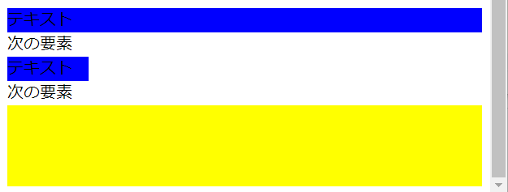  

`<html>`と`<body>`も、すべての要素の外側にあるブロックレベル要素です。  

参考：[MDN ブロックレベルコンテンツ](https://developer.mozilla.org/ja/docs/Glossary/Block-level_content)


#### インライン要素
行の中の要素という意味で、ブロック要素と異なり横幅を占有しません。  
span、a、labelなどの要素です。  

レイアウト上の特徴は以下になります。
- 横幅  
要素内容に合わせて自動的に調整されます。  
ブロック要素と異なり横幅を占有しません。  
**widthの指定は出来ません。**（`img`や`input`など一部の要素は例外で、指定できます。）

- 縦幅  
要素内容に合わせて自動的に調整されます。  
**heightの指定は出来ません。**（widthと同様に`img`などは例外です。）

```html  
<!-- 横幅を占有しない為並んで表示される。 -->
<span>テキスト1</span>
<a href="#">リンク１</a>
<span>テキスト2</span>
<span>
  <span>テキスト3</span>
  <span>テキスト4</span>
</span>
```

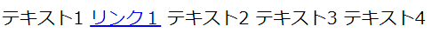  

参考：[MDN インラインレベルコンテンツ](https://developer.mozilla.org/ja/docs/Glossary/Inline-level_content)

長くなるのでここでは概要だけを説明しました。  
ページをレイアウトするうえで重要な概念なので、参照先のURLなどで読んでみて下さい。  


### DOM
ブラウザはHTMLを読み込んだ際、要素の入れ子関係やそれぞれの要素の情報を解析しメモリ上に保持します。  
この解析結果は**DOMツリー**と呼ばれる木構造のデータになります。  

例えば以下のようなHTMLがあった場合
```html
<html>
  <head>
    <title>サンプル</title>
  </head>
  <body>
    <h1>見出し</h1>
    <p>テキストです</p>
  </body>
</html>
```

以下のようなDOMツリーを持ちます。  
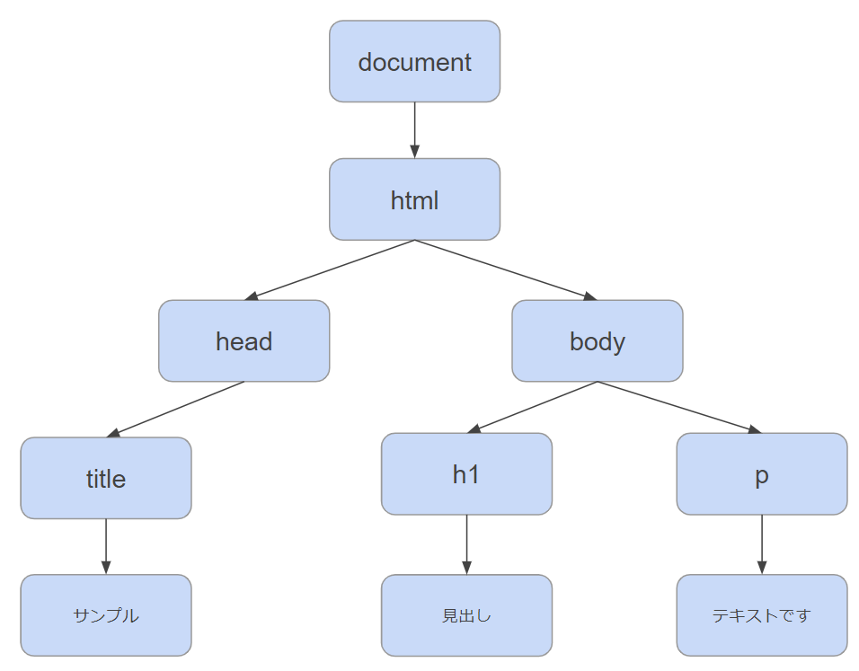

ツリー構造の個々の構成要素を**ノード**(node)といいます。  
ノードは自分自身の情報（その要素の属性など）と、親ノード、子ノードへの参照を持ちます。  
ツリーの一番上の「document」は、HTML全体を表すノードです。  

ブラウザーは、HTMLを解析しDOMツリーを構築した後、CSSのスタイルを適用し画面を描画します。  
このように、HTMLを解釈して画面に表示する一連の工程を**レンダリング**といいます。

ブラウザ上で動作するJavaScriptには、このDOMを操作する為のオブジェクト・メソッドが用意されており、DOM APIと呼ばれています。  
詳しくはJavaScriptの記事で[説明](1_6.Javascriptとは.md#dom-api)します。  

### favicon（ファビコン）
faviconとはブラウザのタブに表示される小さなアイコンの事です。  


```<head>```内の```<link>```タグでアイコンファイル画像を指定します。  

```<link rel="icon" href="myfavicon.ico">```  


### HTMLファイルの確認方法
本記事のHTMLを実際にブラウザで表示したい場合、以下の方法があります。  

- ローカルディスクにHTMLファイルを作成し、ブラウザで表示する  
  メモ帳などのテキストエディタにHTMLの文字列を入力し、拡張子を「.html」にしてファイルを保存します。  
  拡張子を.htmlにするとファイルのアイコンがデフォルトブラウザのものに変わるかと思います。  
  
  
  
  そのファイルをダブルクリックするとブラウザが開きHTMLの内容が描画されます。    
  （もしくはブラウザのURL欄にファイルのフルパスを直接入力して開くことも可能です。）    
  
  この場合ブラウザはHTTPなどの処理は行わず、単純に.htmlファイルの中身を解析して画面を描画します。  

- ブラウザでコーディングできるサービスを利用する  
  ブラウザでHTMLなどのコードを記述しながら結果を確認できるサービスがあります。  
  「[jsFiddle](https://jsfiddle.net/)」や「[CodePen](https://codepen.io/)」などが有名です。  
  
  無料で利用でき作成途中のコードの保存なども出来るので、ちょっとした動作確認で利用すると便利です。

  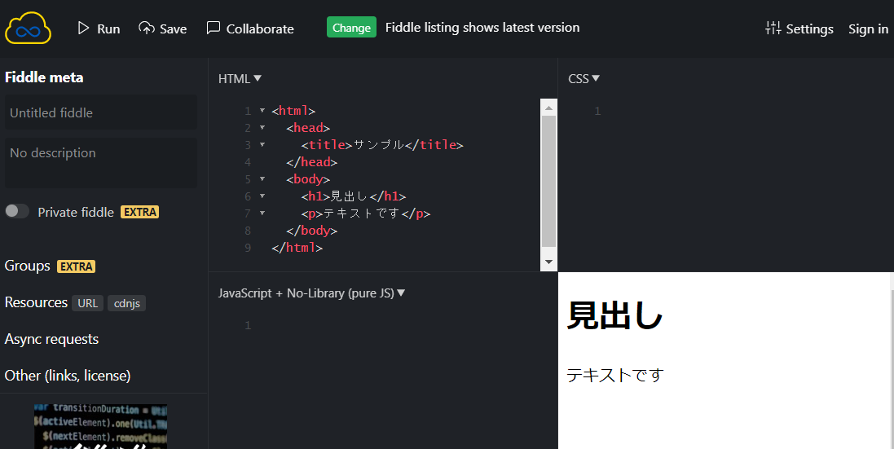


どちらの方法も、HTMLだけではなくCSS・JavaScriptの確認にも利用できます。  


### ブラウザで閲覧中のWebサイトのHTMLの表示
ChromeなどのブラウザでWebサイトを開き、画面上で右クリック→「ページのソースを表示」 を選択すると、そのサイトのHTMLを見ることが出来ます。  
自分が普段見ているサイトのHTMLを見て勉強してみるのもいいかも知れません。  


## 参考資料  
- Webサイト  
  [HTML の学習: ガイドとチュートリアル](https://developer.mozilla.org/ja/docs/Learn_web_development/Core/Structuring_content)   

  [MDN HTMLについて](https://developer.mozilla.org/ja/docs/Web/HTML)  
  
  [MDN HTML要素リファレンス](https://developer.mozilla.org/ja/docs/Web/HTML/Reference/Elements)  

- 書籍  
  [HTML解体新書](https://www.borndigital.co.jp/book/25999.html)  

