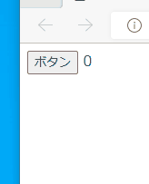
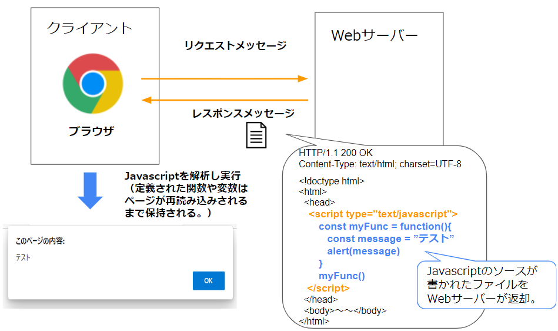
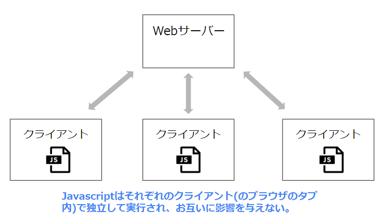

# JavaScriptとは

## JavaScriptとは
JavaScriptはブラウザ上で動作できる、インタプリタ方式、オブジェクト指向のプログラム言語です。[^1]  
   
[^1]: インタプリタ方式とは、コンピュータでプログラムを処理する方法の一つで、ソースコードをその場で解析しながら処理を実行します。  
インタプリタ方式の反対はコンパイラ方式と呼ばれ、事前にソースコードを機械語の実行ファイルに変換しておく必要があります。  
なお、実際のブラウザのJavaScriptエンジンは、高速化のため実行時に内部でコンパイル（JITコンパイル）も行っています。開発者が事前にビルドする必要がない、という点でインタプリタ方式と理解しておけば問題ありません。  

JavaScriptを用いて、ブラウザ上でのWebページのふるまいをプログラム出来ます。  
例えばあるボタンが押された際に画面の表示を変更したり、サーバーと通信したりすることが出来ます。  
以下の例では、ボタンクリック時に画面上のカウントを増やす処理をJavaScriptで記述しています。    
```html
<script>
  let count = 0;

  function countUp () {
    count += 1;
    document.getElementById("count").textContent = count;
  }
</script>

～中略～

<button onclick="countUp()">ボタン</button>
<span id="count">0</span>
```
上記のコードはブラウザ上では以下の動作になります。    

   

ブラウザ上で動作するJavaScriptには、ボタンがクリックされた、などの出来事(**イベント**)をきっかけに処理を実行するための仕組みや、HTML要素を操作する為の関数が用意されています。      
それらの機能を使って画面のふるまいを定義していきます。  

JavaScriptもHTML、CSSと同じく標準化団体によって仕様が定められており、各ブラウザはその仕様に準拠して実装されています。    
その為、基本的にはどのブラウザでも同じようにJavaScriptは実行されます。  
（ただし、新しい機能はブラウザやそのバージョンによって未対応の場合があるため、対象ブラウザで動作するか確認が必要です。）  

※ちなみに、JavaScriptは[Java](https://www.java.com/ja/download/help/whatis_java.html)とは全く関係のない別の言語です。  
（名前にjavaとついていて構文も似ていますが全くの別物です。）  
  
## JavaScriptの仕様 
JavaScriptの仕様も標準化団体によって定められているのですが、以下の2つの仕様があります。  

1. JavaScript自体の言語仕様  
   例えば変数やメソッドの定義の仕方などの、基本的な文法の定義です。  
   Ecma InternationalのTC39という委員会により定義されており、その仕様は[ECMAScript](https://tc39.es/ecma262/)と呼ばれています。  

1. Webブラウザ環境で実行する場合特有の機能の仕様  
   HTML要素の操作など、ブラウザ環境で実行される場合にだけ利用できるオブジェクトやメソッドがあります。  
   これらは**Web API**と呼ばれ、[HTML Living Standard](https://html.spec.whatwg.org/)、DOM、Fetchなど、主にWHATWGが策定する複数の仕様で定義されています。  
  
   JavaScriptをサーバーサイドで動かす場合もあるのですが、その場合ブラウザ特有の機能(Web API)は利用できません。[^2]  

   [^2]: サーバー側で動作させる際には、Node.jsという実行環境（ランタイム）がよく使われます。 

   
**JavaScript自体の言語仕様については範囲が広すぎるのでここでは説明しません。**  
以下のサイトなどを参照下さい。  
[JavaScript Primer](https://jsprimer.net/)

以下ではブラウザ上で動作する場合のJavaScriptの動作について説明していきます。  
JavaScriptの基本的な文法（ifやforなど）は分かっている前提で進めますので、分からない方は一度上記の参考サイトなどを読んでみてください。    

## ブラウザでのJavaScriptの実行
ブラウザはJavaScriptの実行エンジンをもっており、JavaScriptのソースコードをその場で解析・実行できます。  
JavaScriptはインタプリタ方式の言語の為、事前にソースコードをビルドする必要はありません。  
その為、サーバー側にはJavaScriptを解析するためのエンジンは必要ありません。  
サーバー側はブラウザ上で動作させたいJavaScriptのソースをブラウザに返却するだけになります。 

JavaScriptのソースはHTML内の`<script>`タグ内に記載されている場合と、別ファイルに定義されている場合があります。  
詳しくは後述します。  

  

JavaScriptに定義された関数や変数は、別ページを表示する、またはページが再読み込みされるまで保持されます。  
違うURLへの遷移やページリフレッシュなどで画面全体が再読み込みされた場合、読み込んだJavaScriptの情報(定義されていた変数や関数など)はクリアされます。  

JavaScriptの実行結果は、JavaScriptを実行したブラウザのタブのみに影響します。    
他のクライアントのブラウザはもちろん、基本的には同じブラウザの他のタブにも影響しません。[^3]  

[^3]: 異なるクライアント間で共有したい情報は、サーバー側で保持しておく必要があります。  
例えば登録したユーザーの情報などです。  
データの保管先としては、永続的に保管したい情報はデータベースに保存されることが大半です。  
一時的な情報はAPサーバーのセッション機能が利用されたりします。  
詳しくは別記事で解説します。     
（なお、同じブラウザで同じサイト（オリジン）のページを開いているタブ間であれば、`localStorage`などのブラウザの保存領域を使って情報を共有することもできます。）  

  

## HTML内のJavaScriptの記載場所
JavaScriptはHTMLファイル内に記載することが出来ます。  
記載方法は３つあります。  


### `<script>`タグの内部に記載する  
HTMLの`<script>`タグ内に記載します。  
そこで定義した関数を、イベント発生時に呼び出すなどします。   

例  
```html
<script>
  function myOnClick(){
    alert("サンプルです。")
  }
</script>

～～略～～

<button onclick="myOnClick()">クリック</button>
```


### 外部ファイルに記載し、`<script>`タグから参照する
CSSと同じように、JavaScriptもHTMLと別のファイルに定義できます。  
HTMLの`<script>`タグの`src`属性でそのファイルのURLを指定すると、ブラウザがそのファイルを読み込み適用してくれます。 

・外部JavaScript
myscript.js
```js
function myOnClick(){
  alert("サンプルです。")
}
```

・HTML
```html
<!-- srcに指定したパスから取得した外部JSがここに埋め込まれるイメージ。 -->
<script src="http://～/myscript.js"></script>

～

<button onclick="myOnClick()">クリック</button>
```

複数のページで使われる共通の処理は外部ファイルとして定義した方がいいです。  
そのページ(HTML)内でのみ利用される処理もキャッシュなどを考えると基本外部ファイルにした方がいいのですが、実装の都合上scriptタグ内に直接書く場合もあります。 

### 要素のイベント属性に直接記載する  
HTMLのイベントハンドラ属性(後述)に直接記載します。  
例  
```html
<button onclick="alert(`サンプルです`)">クリック</button>
```

この方法はHTMLとJavaScriptの処理が混在して保守しにくくなる為、複雑な処理を書くことは推奨されません。  
呼び出したい関数を指定する程度の使い方にするのが良いです。  


## JavaScriptが実行されるタイミング
JavaScriptはブラウザに解析された際にすぐに実行されます。  
ブラウザはページ表示時にHTMLを解析する際、上から順にタグを解析していくのですが、`<script>`タグが現れたタイミングでそこに記載されたJavaScriptが実行されます。  
（`defer`属性などを付けると実行タイミングを変えられます。後述します。）  

最初の画面表示時に関数・変数の定義や、**イベント**（ボタンクリックなど）と関数の紐付けを行っておき、実際にそのイベントが起こった際に定義した関数が実行される、という作りになることが多いです。  
（この記事先頭のサンプルのようなイメージです）  

### scriptタグを記載する位置
上述した通り、`<script>`タグが現れたタイミングで、そこに記載されたJavaScriptはすぐに実行されます。  
ただそのタイミングでは全てのHTMLの解析が終わっていない場合、HTML要素に関する処理を実行しても反映されないことがあります。  
ある要素に対する処理を書いても、その要素が`<script>`タグより下で定義されている場合、まだブラウザに認識されていないため処理に失敗します。  

```html
<script>
  //あるボタン要素がクリックされた際の処理を設定しようとしているが、
  //対象のボタン要素が<script>タグより下にありまだ読み込まれてない為、失敗する。
  document.getElementById("mybutton").onclick = function() {
    //ボタンクリックした際の処理
  };
</script>

<!-- <script>タグより後に定義されている。 -->
<button id="mybutton">ボタン</button>
```

この場合、対象要素より後に`<script>`タグを記述すると正常に動作します。

```html
<body>
  <button id="mybutton">ボタン</button>

  <script>
    //既に出現している要素のため処理が可能。
    document.getElementById("mybutton").onclick = function() {
        //～～
    };
  </script>
</body>
```

このような順序の問題を避けるため、`<script>`タグは`<body>`タグの末尾に書く、というコーディングルールがある場合もあります。   
または、後述する`window`の`load`イベント、`document`の`DOMContentLoaded`イベントを利用することでも、タグの記述順序の問題を解消することが出来ます。  

外部ファイルを読み込む`<script>`タグには、以下の属性を付けて実行タイミングを指定することもできます。  
現在は`defer`を付けて`<head>`内に書く方法が一般的です。  

- `defer`  
  HTMLの解析を止めずにファイルを取得し、HTMLの解析が終わった後に、記述した順に実行します。  
- `async`  
  HTMLの解析を止めずにファイルを取得し、取得でき次第すぐに実行します。（実行順は保証されません。）  
- `type="module"`  
  JavaScriptをES Modules（`import`/`export`が使える形式）として読み込みます。`defer`と同様に、HTMLの解析後に実行されます。  

```html
<head>
  <script src="myscript.js" defer></script>
</head>
```

## イベント 
イベントとは、ある要素に対して行った動作や、起きた出来事の事です。  
(クリックされた、キーが押された、要素が読み込まれた、など)

このようなイベントの発生をきっかけに、特定の処理を行うことが可能です。  
例えば、登録ボタンが押されたら、登録内容が正しいかチェックする関数を実行する、などです。

イベントとイベントが発生した際に実行する処理を紐付けるために、**イベントハンドラ**という仕組みが用意されています。   

### イベントハンドラでイベントと処理を紐付ける方法
イベントの種類ごとに処理を登録するためのイベントハンドラが用意されています。  
例えば、クリックイベントの場合は`onclick`、何らかのキーが押されたイベントの場合は`onkeydown`というハンドラが用意されています。   
このハンドラに対して実際に実行したいJavaScriptの処理を指定します。  
ハンドラは要素ごとに指定可能です。    
  
例えばあるボタン要素にクリックイベントが発生した際に実行する処理を指定する場合は、以下のように記載します。    
```html
<button onclick="alert('テスト')">ボタン</button>
```
この場合、このボタン要素がクリックされると`alert('テスト')`が実行されます。  

  

この例ではHTMLの属性を利用して実行したいJavaScriptを指定しています。  
イベントハンドラの設定方法は複数あり、後ほど説明します。        

イベントハンドラは様々なイベントに対して用意されています。  
例えば以下のようなものがあります。 

- onkeydown  
要素がフォーカスされている時にキーボードのキーが押された際に実行されます。   
（以前は`onkeypress`もよく使われていましたが、現在は非推奨です。）  

- ondblclick   
要素がダブルクリックされた際に実行されます。    

特定の要素に対するイベントだけではなく、Webページ全体やHTML全体に関するイベントのハンドラも存在します。  

- `window`の`load`イベント（`window.onload`）  
ページ全体が、スタイルシートや画像などのすべての依存するリソースを含めて全て読み込まれたときに発生します。

- `document`の`DOMContentLoaded`イベント  
HTMLの初期文書が完全に読み込まれ解釈された時点で発生します。  
スタイルシート、画像、サブフレームの読み込みが完了するのは待ちません。  
（`onDOMContentLoaded`という属性は無いため、`addEventListener`で登録します。）

(window、documentが何かは後ほど説明します。)  

その他にも様々なイベントが定義されています。  
[イベント一覧](https://developer.mozilla.org/ja/docs/Web/API/Document_Object_Model/Events)

### イベントハンドラへの処理の登録方法
イベントハンドラへ処理を登録する方法は３つあります。  

- インラインイベントハンドラー  
例で紹介したように、HTML要素の属性として実行するJavaScriptを記述する方法です。  

   ```html
   <button onclick="const message='テスト';alert(message)">ボタン</button>
   ```
   scriptタグで定義した関数を指定する事も出来ます。  
   ```html
   <script>
     function showMessage()  {
       alert("テスト")
     }
   </script>

   <button onclick="showMessage();">ボタン</button>
   ```

  この方法だとHTMLとJavaScriptの処理が混在し、文字列のダブルクォートなども気にしないといけなくなる為、保守しにくくなります。  
  また要素数が増えるとどこにイベントが書かれているか把握しにくくなります。  
  その為、あまり使用は推奨されません。  
  (ただ動作をイメージしやすい為、この記事のサンプルはこの登録方法で記載しています。)  

- DOM APIで取得した要素に指定  
後述するDOM APIを利用して要素を表すJavaScriptのオブジェクトを取得出来ます。  
（例えば`document.getElementById('mybutton')`は、id属性が`mybutton`の要素を取得する関数です。詳しくは[DOM API](#dom-api)の項で説明します。）  
その要素オブジェクトに対してイベントと処理を指定できます。  

   ```html
   <button id="mybutton">ボタン</button>

   <script>
     function showMessage(e)  {
       alert("テスト")
     }
     
     //対象の要素を取得
     const button = document.getElementById('mybutton');
     //イベント発生時の処理を指定する。
     button.onclick = showMessage;
   </script>
   ```

- addEventListenerでの指定  
DOM APIで取得した要素オブジェクトには、`addEventListener`という関数が用意されています。  
この関数経由で設定すると、1つのイベントに対し複数の処理を指定できます。  
（イベント発生時に登録した順に処理が実行されます。）  

   ```html
   <button id="mybutton">ボタン</button>

   <script>
     function showMessage1()  {
       alert("テスト1")
     }
     
     function showMessage2()  {
       alert("テスト2")
     }
     
     //対象の要素を取得
     const button = document.getElementById('mybutton');
     //処理を登録
     button.addEventListener('click', showMessage1);
     button.addEventListener('click', showMessage2);
   </script>
   ```


実際の開発ではaddEventListenerが利用されることが多いです。  

イベントハンドラに指定した関数には、イベントに関する情報を保持したイベントオブジェクトが引数として渡されます。  
イベントオブジェクトは、イベントが発生した要素の情報や、イベントをキャンセルする為の関数などを持ちます。  
[MDN イベントオブジェクト](https://developer.mozilla.org/ja/docs/Web/API/Event)
 
イベントに関する詳しい情報は以下のページを参照ください。  
[MDN イベントへの入門](https://developer.mozilla.org/ja/docs/Learn_web_development/Core/Scripting/Events)   

## Web API
ブラウザ環境で実行されるJavaScriptには、ブラウザやWebページを操作する為の、様々なオブジェクトやメソッドが用意されています。  
これをWeb APIと呼びます。  

Web APIには例えば以下のようなものがあります。  

- windowオブジェクト  
  Webページを表示しているウィンドウの情報や、それを操作する為の関数を保持します。  
  ページを表示しているタブ自体の情報を持つオブジェクトというイメージです。    
  タブブラウザーでは、それぞれのタブが個々のwindowオブジェクトで表されます。  
  
  例えば、メッセージダイアログを表示する`alert`という関数もwindowオブジェクトが持つ関数の一つです。  
  windowオブジェクトが持つ関数は、`window.`の部分を省略して呼び出すことが可能です。  
  例えば`window.alert()`を省略して`alert()`と呼び出すことが可能です。  

  ページ全体に関するイベントのハンドラは、このwindowオブジェクトが持っています。  
  例：loadイベント(ページが読み込まれた際のイベント)発生時の処理の登録
  ```js
  window.addEventListener('load', function(){
    alert('ページが読み込まれました。');
  });
  ```
  
  参考：[MDN Window](https://developer.mozilla.org/ja/docs/Web/API/Window)

- documentオブジェクト  
  HTMLを解析した結果である[DOM](1_4.HTMLとは.md#dom)を表すオブジェクトです。  
  HTML要素に関する操作はこのオブジェクトを起点に行います。  

  HTML全体に関するイベントは、このdocumentオブジェクトで受け取れます。  
  例：DOMContentLoadedイベント(HTMLが全て解析された際のイベント)発生時の処理の登録
  ```js
  document.addEventListener('DOMContentLoaded', function(){
    console.log('HTMLが読み込まれました。');
  });
  ```
    
  HTMLを操作する為のオブジェクト・関数群は**DOM API**と呼ばれます。  
  よく利用される為、次の項で解説します。 

  参考：[MDN Document](https://developer.mozilla.org/ja/docs/Web/API/Document)

- historyオブジェクト  
  ブラウザの戻る・進むに関する処理を行う関数を保持しています。  
  参考：[MDN HistoryAPI](https://developer.mozilla.org/ja/docs/Web/API/History)

- fetch関数  
  JavaScript上からHTTPリクエストを送る為の関数です。  
  fetchの使用例は[別記事](3_1.ブラウザがHTTP通信を行うタイミング.md#http通信処理の実装方法)で解説しています。  

  参考：[MDN FetchAPI](https://developer.mozilla.org/ja/docs/Web/API/Fetch_API)


他にも様々なAPIが用意されています。  
[Web API 一覧](https://developer.mozilla.org/ja/docs/Web/API)  

これらのAPIを利用し、JavaScriptからWebページを操作します。  

## DOM API
ブラウザが読み込んだHTML要素を操作する為のオブジェクト・関数群です。  
`document`オブジェクトを利用しHTML要素を表すオブジェクトを取得し、そのオブジェクトを通して要素の情報を変更することが出来ます。  
またHTML要素の追加・削除なども行えます。  

それぞれのやり方をいくつか紹介します。  

### 要素の取得
特定の条件に合致する要素を取得できます。  
(以下のサンプルコードでは`<script>`タグは省略しています。)

#### idで取得
```js
const element = document.getElementById("myid");
```
```html
<span id="myid"></span>
```

#### class名で取得
```js
//条件に合う要素が複数ある場合もあるため、戻り値は要素の一覧（HTMLCollection）になる
const elements = document.getElementsByClassName("myclass");
const first = elements[0]; //1つ目の要素
```
```html
<span class="myclass"></span>
```

#### CSSセレクタで取得
```js
//条件に合う最初の1つの要素を取得する
const element = document.querySelector('#myid');
```
```html
<span id="myid"></span>
```
条件に合う要素を全て取得したい場合は`document.querySelectorAll`を使います。  

他にもタグ名やname属性を条件に取得できます。  

`getElementById`や`querySelector`の戻り値は、`Element`オブジェクトになります。  
`Element`オブジェクトは取得した要素の情報を保持しています。  
条件に合う要素が見つからなかった場合は`null`が返ります。  
`getElementsByClassName`のように複数の要素を取得する関数の戻り値は、`Element`オブジェクトの一覧になります。  

### 要素の情報の変更
前述したとおり、`getElementById`などの戻り値は、`Element`オブジェクトになります。  
この`Element`オブジェクトを通して要素の値を変更することなどが出来ます。 
```js
const element = document.getElementById("myButton");

//表示されるテキストを変更
element.textContent = "ボタンB";

//属性の取得（多くの標準属性は 要素ノード.属性名 で取得可能）
const id = element.id; 
//getAttributeでも取得可能
const id2 = element.getAttribute('id');

//属性の追加(属性名、値)
element.setAttribute('name', 'myButtonName');

//イベントを設定
element.addEventListener('click', function(){ alert("test"); }); 
```
```html
<button id="myButton">ボタンA</button>
```

他にも様々な操作を行えます。  
[MDN Element](https://developer.mozilla.org/ja/docs/Web/API/Element)

### 要素の追加
DOM APIを利用して、動的に要素を追加することも可能です。  
`document.createElement`という関数を利用します。  

例）  
```html
<button id="mybutton">ボタン</button>
<div id="container"></div>

<script>
  let i = 0

  //イベントに設定する関数
  function addElement()  {

    //新しいボタン要素を作成する。
    const newBtn = document.createElement("button"); //要素を作成
    newBtn.textContent = "ボタン" + i; //作成した要素の表示テキストを設定
    newBtn.name = "button" + i; //name属性を設定

    //作成したボタン要素にイベントを設定
    newBtn.addEventListener('click', (e) => {
      alert(e.target.name) //クリックされたボタン要素のname属性の値をalertで表示
    });

    //特定の要素の下に作成したボタン要素を追加
    const container = document.getElementById("container");
    container.appendChild(newBtn); 

    i++;
  }
  
  //元から表示されているボタンのクリックイベントに、新しいボタンを作成する関数を設定
  const button = document.getElementById('mybutton');
  button.addEventListener('click', addElement);
</script>
```

  

他にも要素の削除など、様々な操作を行えます。  
[DOM API一覧](https://developer.mozilla.org/ja/docs/Web/API/Document_Object_Model)  

※DOM APIは、[Ajax](3_1.ブラウザがHTTP通信を行うタイミング.md#ajaxの実装)と呼ばれる処理でもよく利用されます。  
また、画面遷移の際にページ全体を再読み込みせず、DOM APIなどを使ってJavaScriptで表示を切り替える作りのWebシステムもあります。  
そのような作りのWebシステムはSPA(シングルページアプリケーション)と呼ばれます。  
（詳しくは[別記事](3_4.SPAとは.md)で解説します。）

## 参考情報

[JavaScript Primer](https://jsprimer.net/)  
JavaScriptの基本的な文法が解説されています。  

[MDN JavaScriptの学習](https://developer.mozilla.org/ja/docs/Learn_web_development/Core/Scripting)  

[イベントへの入門](https://developer.mozilla.org/ja/docs/Learn_web_development/Core/Scripting/Events)   

[Web APIとは](https://developer.mozilla.org/ja/docs/Learn_web_development/Extensions/Client-side_APIs/Introduction)

[Web API 一覧](https://developer.mozilla.org/ja/docs/Web/API)

[DOMとは・DOM API一覧](https://developer.mozilla.org/ja/docs/Web/API/Document_Object_Model)  
