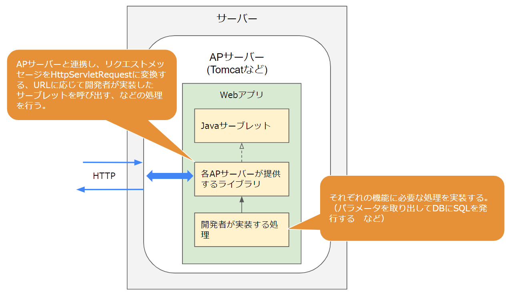
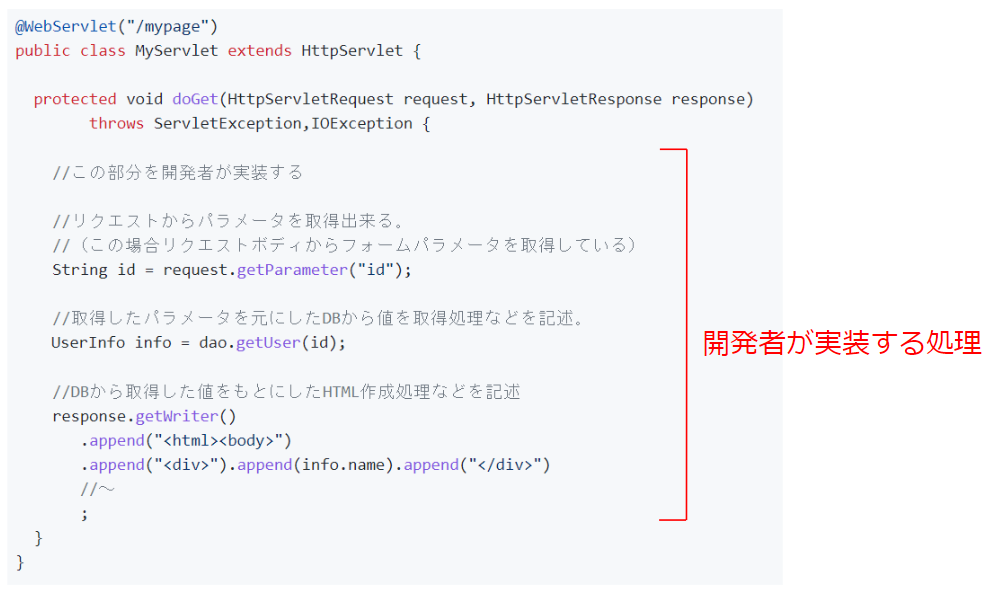
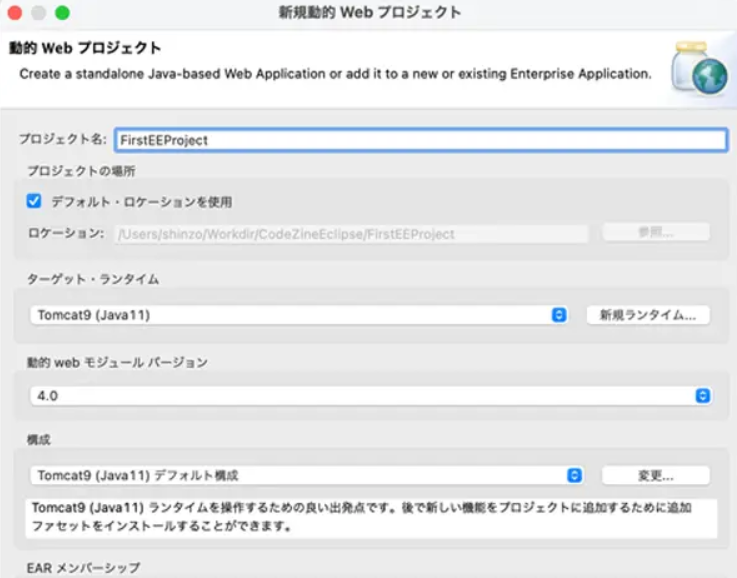
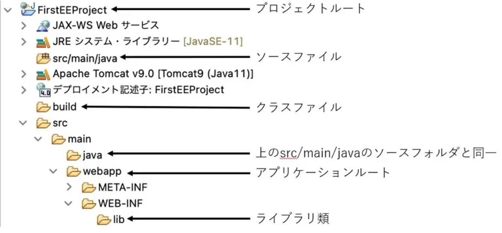
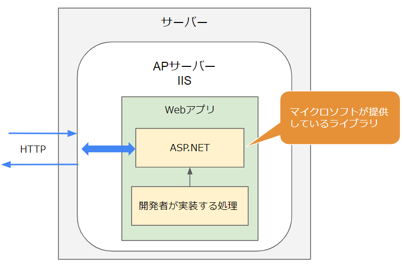
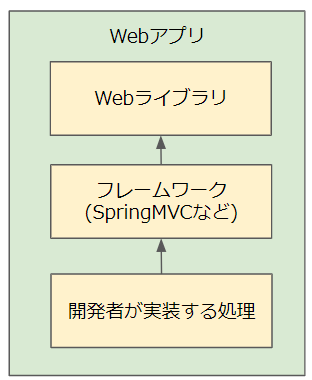
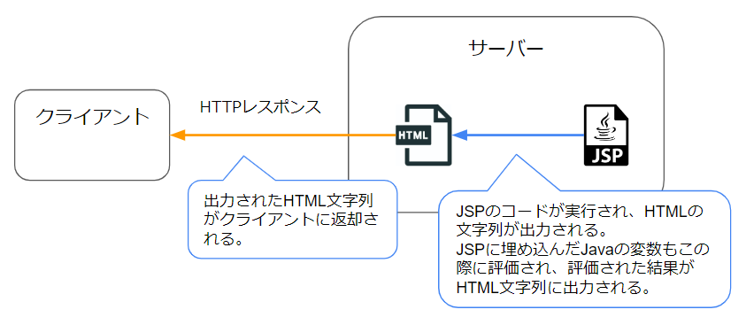
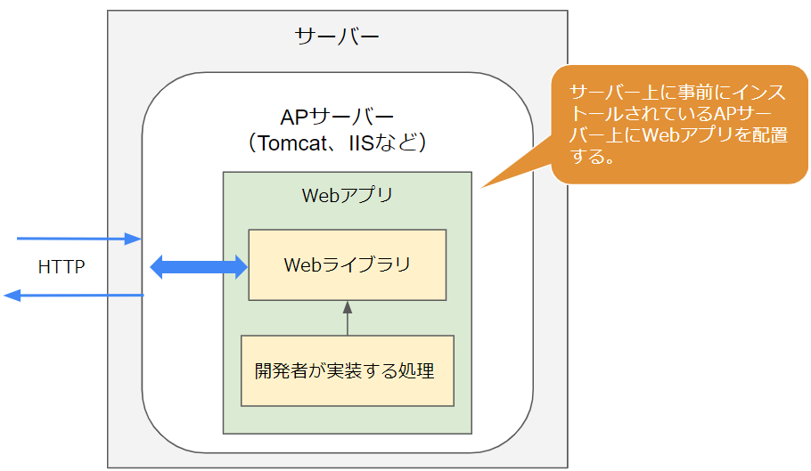
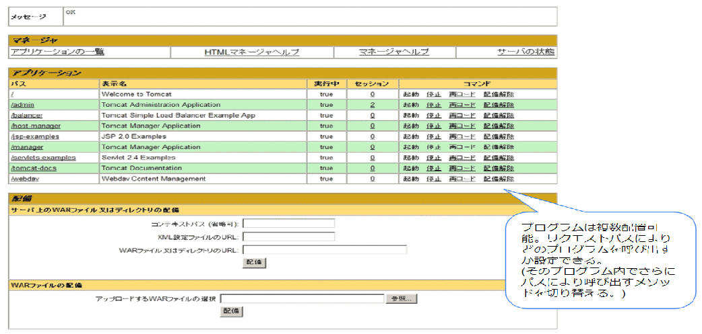
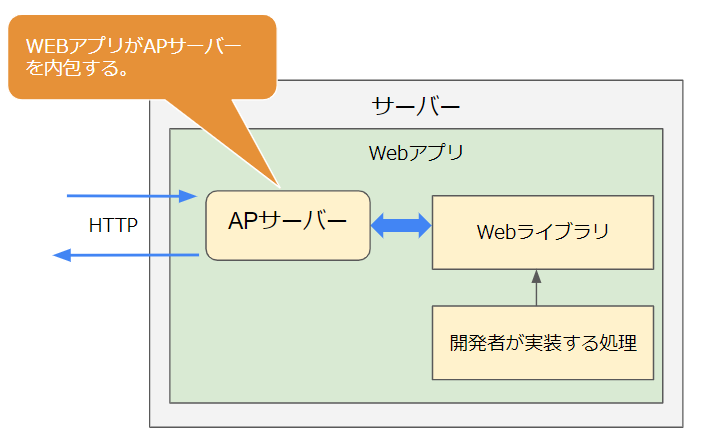

# Webアプリケーションの実装

## なにこれ？ 
Webアプリケーション(以下Webアプリ)とはアプリケーションサーバー上で動作するプログラムのことです。  
ここでは、Webアプリをどのように実装するかについて説明します。  

## アプリケーションサーバーに配置できるプログラム
APサーバーにはどんなプログラムでも配置できるわけではありません。  
(ここでいうAPサーバーはTomcatやIISなどのAPサーバーアプリのことです。)  
例えば、Mainメソッドでコンソール画面にHelloWorldと出力するだけのプログラムはAPサーバーに配置できません。  

**APサーバーに配置できるのは、APサーバーが想定する仕様にそって実装されたプログラムだけです。**  
この仕様は言語やAPサーバーごとに決められています。  

たとえばJavaには「**Java Servlet**(サーブレット)」というWebアプリの為の仕様があり、Java系のAPサーバー（TomcatやJBossなど）はこの仕様に沿って実装されたプログラムが配置できるように作られています[^1]。    
逆に言うとJavaサーブレットの仕様に沿っていないプログラムは、TomcatやJBossといったAPサーバーには配置できません。  

[^1]: その為これらのAPサーバーは「サーブレットコンテナ」とも呼ばれます。

それらのAPサーバーに配置するWebアプリを開発する場合、開発者はJavaサーブレットの仕様に沿ってプログラムを実装していくことになります。  

以降ではJavaでWebアプリ開発する場合を例に、具体的な実装方法について説明していきます。  
(他の言語も大体似たような仕組みのはずです)  

## JavaでのWebアプリ開発
Javaには「**Java Servlet**」というWebアプリの為の仕様があると説明しました。  
以降ではこのJava Servletについての概要を説明します。    

### Java Servletとは
Java Servletとは、Webアプリが実装すべきクラス・メソッド・インターフェースなどを定義した仕様です。  
(以降ではJava Servletを省略して**サーブレット**と記載します。)  
現在は「Jakarta Servlet」という名前で、Jakarta EEの仕様の1つとして[jakarta.ee](https://jakarta.ee/specifications/servlet/)で管理されています。  

サーブレットの[定義書（Servlet 4.0のAPIドキュメントの日本語訳）](https://github.megascus.dev/servlet-spec/docs/apidocs/)を見ると、様々なクラスやインターフェースが定義されています。  
例えばリクエストメッセージを表す「```HttpServletRequest```インタフェース」や、レスポンスメッセージを表す「```HttpServletResponse```インタフェース」などが定義されています。

```HttpServletRequest```の[定義](https://github.megascus.dev/servlet-spec/docs/apidocs/javax/servlet/http/HttpServletRequest.html)をみると、以下のように記載されています。  
> 「サーブレットコンテナはHttpServletRequestを作成してサーブレットのservice(doGet、doPost、など)メソッドの引数として渡します。」

また、```HttpServletRequest```で定義されている各メソッドについても説明されています。  
例えば以下のようなメソッドが定義されています。  

> String getHeader(String name)
> 
> リクエストヘッダーの指定された値をStringとして返します。 リクエストが指定された名前のヘッダーを含まない場合はnullを返します。 もしヘッダーに同じ名前で複数の値が含まれていた場合、このメソッドはリクエストの最初のヘッダーを返します。 ヘッダー名は大文字小文字を区別しません。 このメソッドは任意のリクエストヘッダーに対して使用できます。
> 
> パラメータ:
> name - ヘッダー名を指定する名前のString
> 戻り値:
> リクエストのヘッダーの値を含むString、リクエストのヘッダーがその名前を持たない場合はnull

このように、サーブレットでは以下の仕様が定義されています。  
- ある情報をどのクラス、インターフェースで表現するか  
例えばリクエストメッセージの情報は「```HttpServletRequest```」で表現される。  

- その情報はどのように作成されるか  
「サーブレットコンテナはHttpServletRequestを作成してサーブレットのservice(doGet、doPost、など)メソッドの引数として渡します。」など

- そのクラス、インターフェースはどのようなメソッドを持ち、そのメソッドはどのような処理を行うべきか  
「getHeaderメソッドはヘッダーの値を返却する」など

- そのメソッドはどのようなシグニチャか

※ シグニチャとは、メソッド名、引数の数とそれぞれの型、返り値の型の定義の事です。  

重要なのは、サーブレットはあくまで「こういったクラスやメソッドを実装する必要がある」という仕様を定義しているだけで、**実装は提供していない**ということです。  

### Java Servletの実装
開発者がサーブレットの実装をすることは難しいです。  
例えば```HttpServletRequest```の```getHeader```メソッドは、そもそもAPサーバーがどのようにリクエストメッセージを保持しているか分からないと実装できません。   

ではサーブレットの実装はどのように提供されるのでしょうか？  
**サーブレットの実装は、各APサーバーにより提供されます。**  

HttpServletRequestを実装したクラスや、リクエストメッセージからそれを作成する処理などは、TomcatなどのAPサーバー本体に含まれています。  

一方、開発者がプログラムを作成・コンパイルする際に参照するのは、仕様で定義されたインターフェースやクラス（`HttpServletRequest`や`HttpServlet`など）をまとめたjarファイルです。  
例えばTomcatでは「servlet-api.jar」という名前で同梱されています（Mavenなどでは「jakarta.servlet-api」というライブラリとして入手できます）。  
各APサーバーの実装は同じ仕様（インターフェース）に従っているので、クラス名やメソッドのシグニチャは同じです。  
その為、どのAPサーバーで動かす場合でも、開発者が書くプログラムは同じになります。  

開発者は仕様で定義されたクラス・メソッドを利用してプログラムを開発し、実行時にはAPサーバーが提供する実装が呼び出されます。  


### 開発者が実装する部分
HTTPリクエストを受け取り解析する処理や、レスポンスメッセージを作成するような、基本的なHTTP通信に関する処理は、APサーバーが提供しているサーブレットの実装が行ってくれます。  

開発者は、それを利用した具体的な処理を実装していきます。 
例えば、マイページのHTMLを作成する、という処理の場合、DBからユーザーデータを取得したり、それをもとにHTMLを作成する部分を開発者が実装します。  

  

### 実装例
サーブレットの場合、ライブラリが提供する「```HttpServlet```」を継承したクラスを作成し、その中に処理を記述していきます。  
例えば以下のようなコードを記述します。  

```java
//URLのパスが/mypageだった場合に呼ばれる処理
@WebServlet("/mypage")
public class MyServlet extends HttpServlet {

  protected void doGet(HttpServletRequest request, HttpServletResponse response)
        throws ServletException,IOException {

    //この部分を開発者が実装する

    //リクエストからパラメータを取得出来る。
    //（GETリクエストなので、URLのクエリ文字列「/mypage?id=xxx」から取得している）
    String id = request.getParameter("id"); 

    //取得したパラメータを元にしたDBから値を取得処理などを記述。
    UserInfo info = dao.getUser(id);

    //DBから取得した値をもとにしたHTML作成処理などを記述
    response.getWriter()
       .append("<html><body>")
       .append("<div>").append(info.getName()).append("</div>")
       //～
       ;
  }
}
```
※DBにアクセスするためのdaoの初期化処理や、import文などは省略しています。  

開発者はHttpServletを継承したクラスを作成します。  
APサーバーが提供しているサーブレットの実装が、リクエスト内容に応じてそのクラスを呼び出してくれます。  
このサンプルでいうと、URLのパスが```@WebServlet```で指定したパスと一致し、GETメソッドだった場合に、MyServletクラスの```doGet```メソッドが呼び出されます。  
(doGetメソッドはHttpServletに定義されているメソッドをオーバーライドしたものです)    
この呼び出しルールはサーブレットの仕様で定義されています。  

サンプルのMyServletクラスを呼び出す際、APサーバー（サーブレットの実装）は以下の処理を行ってくれています。  
- パスが一致するかの判断
- サーブレットクラスのインスタンス化
- doGetメソッドへ渡す引数（HttpServletRequest、HttpServletResponse）の作成
- doGetメソッドの呼び出し  

他色々   


開発者が実装するのはその後の部分になります。  
  


### Webアプリの作成方法
主要なIDE（Eclipseなどの統合開発環境）には、Webアプリのプロジェクトを簡単に作成する為の機能が用意されています。  
例えばEclipseの場合、以下の画面に必要項目を記述すると、Webアプリ用のプロジェクトを作成してくれます。  
  

Webアプリに必要なライブラリの参照、必要なフォルダや設定ファイルの作成が行われ、必要な初期コードが定義された状態のプロジェクトが作成されます。  
そのまま利用してもいいですし、必要に応じて変更しながら利用できます。  

  


### ここまでのまとめ

- APサーバーに配置できるのは、APサーバーが想定する仕様にそって実装されたプログラムだけ。
- Javaではその仕様は「Java Servlet」と呼ばれる。
- Java Servletの実装は各APサーバーが提供している。
- 仕様で定義されたクラス・メソッドを適切に利用したプログラムがWebアプリ。
- Webアプリのひな形はEclipseなどのIDEから簡単に作成できる。


### .NETのWebアプリ
他の言語の例として、マイクロソフトの.NET(C#、VB)でWebアプリを作成する場合についても簡単に説明します。  

マイクロソフトはWebアプリを構築するためのツールとライブラリ群を提供しており、これは「ASP.NET」と呼ばれます。    
（ライブラリ群はdll形式で提供されており、Javaでいうサーブレットの仕様と実装をまとめたものにあたります。）  

ASP.NETのライブラリ群はマイクロソフトが提供しているもの以外存在せず、従来のASP.NETで作成したWebアプリは、同じくマイクロソフト製のAPサーバーである「IIS」にしか配置できません[^2]。  

  

その為、Javaのように様々なAPサーバーが存在し、各APサーバーがサーブレットの実装を提供している状況とは異なります。  

このように、言語によって少し状況は違います。  
ただどの言語でも、提供されているWebアプリ用のライブラリを利用して開発を行っていくという点で変わりはありません。  

以下Webアプリ用のライブラリを「Webライブラリ」と表現します。  
(サーブレットや、ASP.NETのライブラリなど)  

[^2]: IISにしか配置できないのは.NET Framework上で動く従来のASP.NET（ASP.NET 4.xまで）です。  
後継のASP.NET Coreは、ライブラリ自体がAPサーバーの機能（Kestrel）を内包するようになっており、APサーバーに配置しなくてもそれ自体で独立して動作するようになりました。  
その為、LinuxなどのIISが無い環境でも動作させることが出来ます。    

## Webフレームワーク
上述した通り、WebアプリはWebライブラリを利用して開発していきます。   
ただ、Webライブラリだけを利用した開発には、以下のような問題があります。  
- 開発者が実装しなくてはいけない機能が多い  
  Webライブラリは、HTTP通信の為の基本的な機能だけを提供している物が多いです。  
  例えばサーブレットだと、以下のような機能は、開発者が自分で実装する必要があります。  
  - リクエストパラメータをJavaオブジェクトに変換する処理

  - JavaオブジェクトをJSONに変換してレスポンスする処理

  - その他、認証・多言語対応など

- ソースの記述方法に制限がある場合がある  
たとえばサーブレットの場合、処理はdoGet・doPostなどのHTTPメソッドごとのメソッドに書く決まりになっています。  
1つのクラスに複数のパスを割り当てることは出来ますが（`@WebServlet({"/a", "/b"})`など）、パスごとに処理を分けたい場合は、doGetの中で自分でパスを判定して処理を分岐させる必要があります。  

そのため実際の開発では、Webライブラリをより使いやすくするためのフレームワークを利用することが多いです。  
たとえばJavaの場合は、Spring MVCというフレームワークが有名です[^3]。  

[^3]: MVCはModel-View-Controllerの略で、UIとロジックを分離するための設計手法のこと。

Spring MVCを利用した場合としなかった場合を比較すると、以下のようにコードが変化します。  

Spring MVCを利用しなかった場合  
```java
@WebServlet("/user")
public class MyServlet extends HttpServlet {

  protected void doGet(HttpServletRequest request, HttpServletResponse response)
        throws ServletException,IOException {

    //リクエストパラメータを取り出し。
    String id = request.getParameter("id");

    //データ取得処理など。
    UserInfo info = dao.getUser(id);

    //結果をJSONで返却
    response.setContentType("application/json");
    response.getWriter()
       .append("{\"name\" : \"" + info.getName() + "\",")
       .append("\"age\" : " + info.getAge() + ",")
       .append("\"address\" : \"" + info.getAddress() + "\"}");
  }
}
```

Spring MVCを利用した場合  
```java
@Controller
public class UserController {

  private final UserDao dao;

  //daoはSpringが自動的に生成して渡してくれる（DI：依存性注入）
  public UserController(UserDao dao) {
    this.dao = dao;
  }

  @GetMapping("/user")
  @ResponseBody
  public UserInfo getUserInfo(@RequestParam("id") String id) {  //パラメータが自動的に引数に代入される。
    UserInfo user = dao.getUser(id);
    return user;  //フレームワークでJSON文字列に変換される。
  }
}
```
※UserDao・UserInfoクラスの定義やimport文は省略しています。  

Spring MVCを使った場合は、以下の処理が簡略化されています。  
- リクエストパラメータの取り出し  
リクエストパラメータが引数に自動的に代入されています。  

- レスポンスメッセージへの書き込み  
戻り値のオブジェクトが自動的にJSONに変換され、レスポンスに書き込まれています。    

この例以外でも、Webライブラリには無い様々な機能が提供されています。  
（国際化とローカリゼーション、入力値の検証など。また、Spring MVCの土台であるSpring Framework本体が、依存性注入（DI）やAOPといった機能を提供しています。）  
参考：[Spring MVCの提供機能](https://spring.pleiades.io/spring-framework/reference/web/webmvc.html)  

このようなフレームワークを利用する場合、サーブレットのWebライブラリはフレームワークの裏側に隠ぺいされ、開発者が直接触ることは少なくなります。  
    

フレームワークはサードパーティー製の場合もありますし、言語の開発元自体が作成している場合もあります。  
例えば、.NETのWebフレームワークである「ASP.NET Core MVC」はMicrosoftが開発しています。  

各言語ごとによく使われるWebフレームワークは以下になります。  

|  言語  |  フレームワーク  | 
|  ----  |  ----  | 
| Java | Spring MVC <br/>（昔はStrutsなども使われていました） | 
| .NET |  ASP.NET Core MVC <br/> （.NET Framework版の従来のものは「ASP.NET MVC」と呼ばれていました。）  | 
| Ruby | Ruby on Rails | 


## HTMLを作成しやすくする機能
Webアプリは処理の結果として、動的に作成したHTMLの文字列を返すことが多いです。  

ただ、HTMLは文字数が多くなる為、`String`の文字列を連結して作るのは大変です。  
Stringを連結すると以下のようなコードになってしまいます。  
```java
public class HelloWorld extends HttpServlet {
   public void doGet(HttpServletRequest request, HttpServletResponse response)
         throws ServletException,IOException {

      response.setContentType("text/html;charset=UTF-8");

      String message = "Hello,World!!";
      
      //HTMLをレスポンスに出力
      PrintWriter out = response.getWriter()
        .append("<html><head>")
        .append("<title>Hello, World!!</title>")
        .append("</head><body>")
        .append("<p>" + message + "</p>")
        .append("</body></html>");
   }
}
```  
このようなStringを連結する書き方には、以下の問題があります。  
- 開始タグと終了タグの関連も分かりにくい  
- HTML内のダブルクオーテーションを、Javaの文字列として`\"`のように書く必要があり読みにくい  
- ユーザーが入力した値などを埋め込む際、`<`や`"`などの文字をHTMLエスケープ（`&lt;`や`&quot;`に変換）し忘れやすい  
  エスケープを忘れると、悪意のあるスクリプトを埋め込まれる**XSS（クロスサイトスクリプティング）**という脆弱性の原因になります。  


これを解消する為、大半のWebライブラリでは、HTML作成をサポートする為の機能を提供しています。  
例えばJavaサーブレットであれば、**JSP**という仕組みを持っています[^5]。  

[^5]: Webフレームワーク側で仕組みを持っている場合もあります。  
Spring MVCと組み合わせてよく使われる「Thymeleaf」や、ASP.NET Coreの「Razor」などです。       


### JSPのコード例
以下ではJSPを利用する場合の例を説明していきます。  
（他の方法も大体同じような仕組みです。）   

JSPは .jspという拡張子の外部ファイルに、HTMLのように文字列を記述します。  
Stringを連結した時のような、ダブルクオーテーションや改行文字の挿入処理は必要ありません。  

JSPのコード例
```jsp
<html>
  <head>
    <title>Hello, World!!</title>
  </head>
  <body>
    <% 
    String message = "Hello,World!!";
    for(int i = 0; i < 10; i++){
      out.println("<p>" + message + i + "</p>"); 
    }
    %>
  </body>
</html>
```
`<body>`部分で行っているように、Javaのコードを埋め込む事も可能です。  

※`<% %>`でJavaのコードを直接書く方法（スクリプトレット）は、保守性やXSS対策の観点から、現在は使わないことが推奨されています。  
実際の開発では、EL式（`${message}`のような書き方）やJSTL（`<c:forEach>`、`<c:out>`などのタグ）を使って記述します。  
`<c:out>`を使うと値が自動的にHTMLエスケープされるため、XSS対策にもなります。（`${...}`を直接書いた場合はエスケープされないので注意が必要です。）  

JSPで記述する利点は以下になります。  
- HTMLと同じ感覚で記述できる為、コードの書きやすさ、読みやすさが向上する  
- 繰り返しや条件分岐を記述できる為（`<c:forEach>`・`<c:if>`などのタグや、上の例のようなJavaのコード）、柔軟な記述が可能  

後述しますが、埋め込まれたJavaのコードがクライアントに渡ることはありません。  
Javaのコードを実行した結果（として出力されたHTML）が、クライアントに返却されます。  

### JSPの出力
JSPは、APサーバーによって内部的にサーブレットに変換・コンパイルされます。  
変換されるのは通常、そのJSPに初めてリクエストが来た時です（事前に変換しておくことも出来ます）。  
1つ目の例のコードのような、Stringを連結して出力するサーブレットに変換されるイメージです。    
埋め込まれたJavaのコードは、変換されたサーブレットの一部として、リクエストのたびに実行されます。  

そうして変換されたサーブレットから出力されたHTMLの文字列が、クライアントへのレスポンスメッセージに記載されることになります。  
  


## APサーバーへのWebアプリのデプロイ方法 
Webアプリを作成したら、それをAPサーバー上にデプロイしなくてはいけません。  
デプロイとは「配置する」、「展開する」という意味で、作成したプログラムをサーバーに配置する際によく使われる言葉です。  

Webアプリのデプロイ方法として、以下の2つのパターンがあります。  

### 1.インストール済みのAPサーバーにデプロイする
TomcatやIISなどを事前にサーバーにインストールしておき、そこにWebアプリを配置します。  

  

デプロイ方法は、APサーバーにより異なりますが、基本的には以下の作業を行います。  
- ビルドしたプログラムをAPサーバー上の特定のフォルダに配置  
- APサーバーでパス・ポートとプログラム配置フォルダを対応付ける  

APサーバー側でデプロイの為のメニューが用意されている場合が多いです。  
例えばTomcatは、以下のようなデプロイ用のWebページを提供しており、そこからWebアプリをデプロイ出来ます。  
  

### 2.Webアプリ自体にAPサーバーの機能を内包させる
Webライブラリやフレームワークによっては、Webアプリ自体にAPサーバーの機能を内包させることが出来ます。  
この場合、ビルドしたアプリ単体で動作する事が可能な為、配置先にAPサーバーがインストールされている必要はありません。  

APサーバーを内包可能な主なライブラリ・フレームワークは以下になります。  
- 「Spring Boot」  
Springの各種設定を自動化し、Spring MVCなどを使ったアプリを簡単に作れるようにしたもの。  
Tomcatを内包した形でWebアプリをビルドし、単体で起動することが可能です。  

- ASP.NET Core  

など。

  


これらのライブラリ・フレームワークを使った場合でも、インストール済みのAPサーバーにデプロイすることは可能です。  
どちらの方法向けにビルドするか選択可能となっている場合が多いです。  

※これらのライブラリを用いたプロジェクトをIDEから作成すると、mainメソッドにAPサーバーを実行するコードが記載されています。  
（Spring Bootの場合、Eclipseにプラグイン（Spring Tools）を導入するとSpring Boot用のプロジェクトを作成できます。Webサイトの[Spring Initializr](https://start.spring.io/)からひな形をダウンロードすることも出来ます。）    
Listenするポートなどは設定ファイルで指定可能な場合が多いです。  


## 参考
[MDN サーバーサイドウェブサイトプログラミング](https://developer.mozilla.org/ja/docs/Learn_web_development/Extensions/Server-side)  

[Jakarta Servlet 仕様（jakarta.ee）](https://jakarta.ee/specifications/servlet/)  

[サーブレット仕様 Servlet 4.0 APIドキュメント日本語訳（非公式）](https://github.megascus.dev/servlet-spec/docs/apidocs/)

[Spring MVC](https://spring.pleiades.io/spring-framework/reference/web/webmvc.html)  

[Spring Boot](https://spring.pleiades.io/spring-boot/index.html)  

[ASP.NET](https://dotnet.microsoft.com/ja-jp/apps/aspnet)

