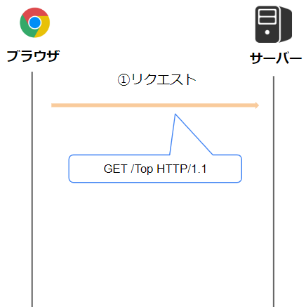
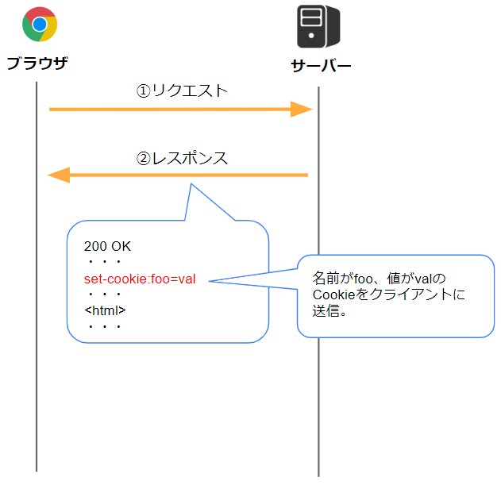
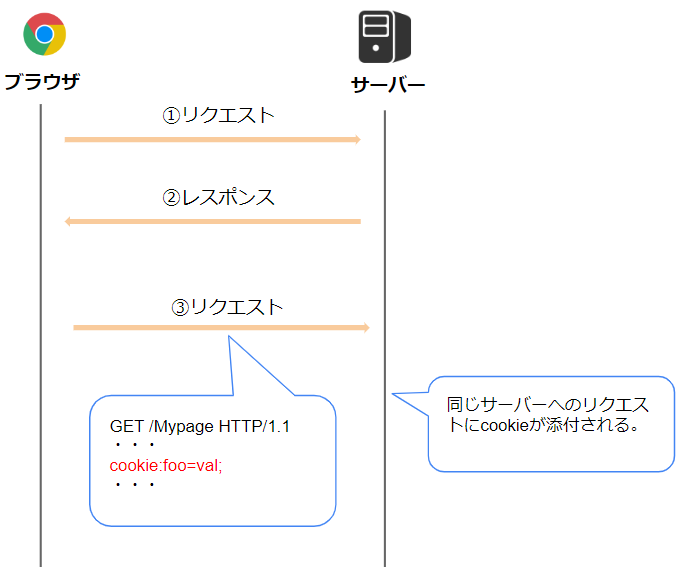
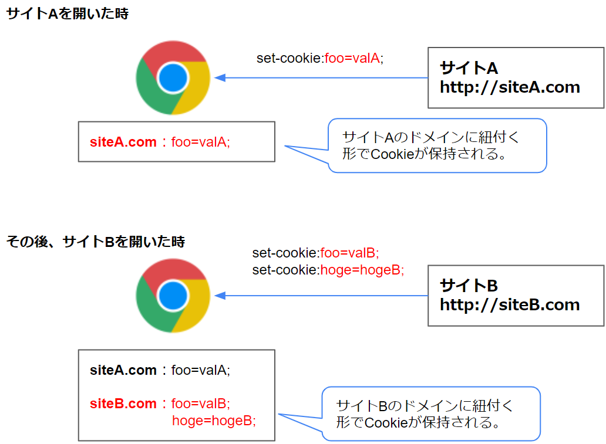
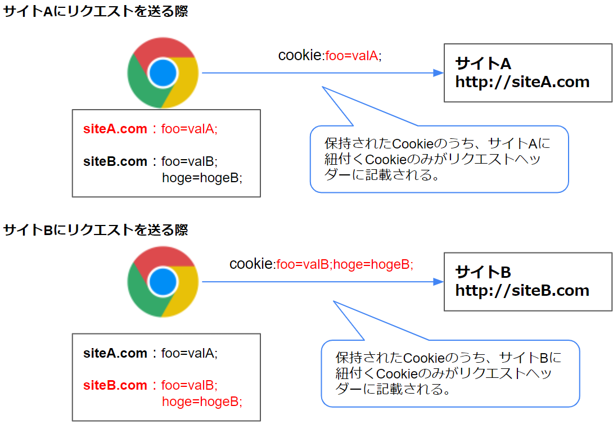
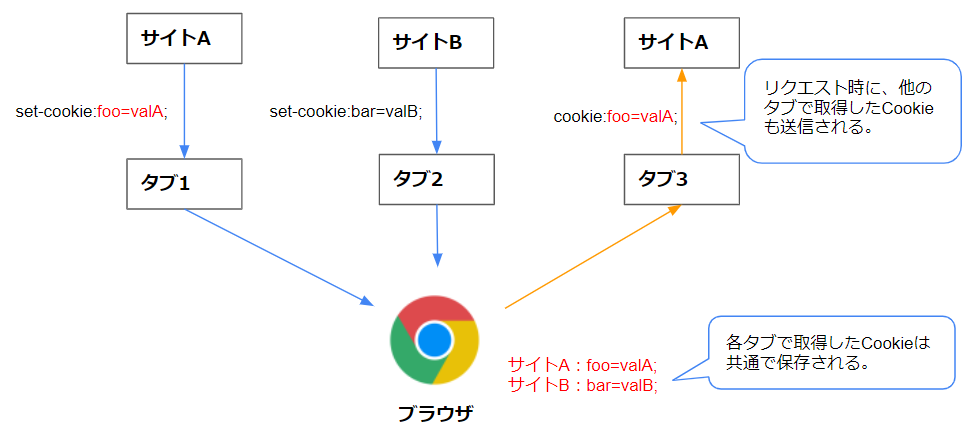
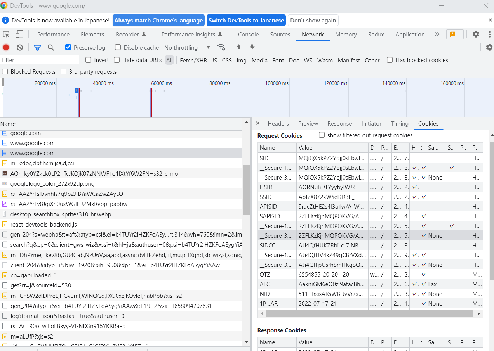
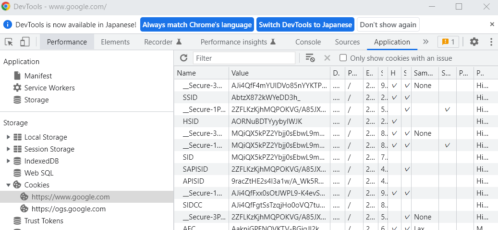

# Cookieとは 


## Cookieとは  
Cookieとは、Webサーバーからブラウザに対して送信され、ブラウザ内で保存される小さな文字列データのことです。  
ブラウザは次回以降同じWebサーバーにリクエストを送る際、保存されたCookieを自動的に送信します。  
送信される際は、HTTPリクエストのヘッダーに記載されて送信されます。    

## Cookieの受け渡し手順  
Cookieをやり取りする手順は以下になります。  

1. ブラウザがHTTPリクエストを送信します。  
  Cookieが付与されていない状態の最初のリクエストです。   
    
  
1. WebサーバーがCookieを返却します。    
  Cookieはレスポンスヘッダーに記載され返却されます。    
    
  
1. ブラウザは返却されたCookieを内部で保持します。  
  それ以降、同じWebサーバーへリクエストを送信する際に、リクエストヘッダーに返却されたCookieの値が記載されます。  
  （ブラウザが自動的にCookieヘッダーを設定してくれます。）  
  URLのホスト名が同一の場合に、同じWebサーバーと判断します。   
  （後述するdomain属性・path属性で、送信する範囲を変えることも出来ます。）  
     
  


## リクエスト・レスポンスヘッダーへの記述ルール
上で説明した通り、Cookieはレスポンス・リクエストメッセージのヘッダーに記載されます。  

### レスポンスヘッダー
Webサーバーから返却されるCookieはレスポンスヘッダーに記述されます。  
ヘッダー名は`Set-Cookie`で、`Set-Cookie: Cookie名=値`という形式で記載されます。    
`Set-Cookie`ヘッダーは複数指定可能です。  

例）  
```http
HTTP/1.1 200 OK
Set-Cookie: my_cookie1=aaaaa
Set-Cookie: my_cookie2=bbbbb
```

上の例では以下の2つのCookieが返却されています。  
Cookie名：my_cookie1、値：aaaaa   
Cookie名：my_cookie2、値：bbbbb  

ブラウザは`Set-Cookie`ヘッダーに記載されたCookieを内部的に保存します。  

保存する際は、リクエストURLのドメインと紐づけて保存されます。[^1]  
  

[^1]:紐づけられるドメインは、後述するdomain属性で変更可能です。  
domain属性が指定されない場合は、Cookie取得時のURLのドメインに対して保存されます。  

同じドメインに対する2度目以降のレスポンスで同じCookie名が返ってきた場合は、保存している情報を上書きします。  
（正確には「Cookie名・ドメイン・パス」の組み合わせが同じ場合に、同じCookieとみなされます。）  


### リクエストヘッダー
あるURLへリクエストを送信する際、そのURLのドメインに紐づくCookieがブラウザに保存されている場合は、その値がリクエストヘッダーに記載されます。  
  

ヘッダー名は`Cookie`で、`Cookie: Cookie名=値`という形式で指定します。   
複数のCookieを送る場合は`;`（セミコロン）で区切って1行に記載します。  
（`Set-Cookie`ヘッダーと違いヘッダーの複数指定は出来ません。）    

例  

```http
GET /sample_page.html HTTP/1.1
Host: www.example.org
Cookie: my_cookie1=aaaaa; my_cookie2=bbbbb
```

### Cookieの属性
レスポンスの`Set-Cookie`ヘッダーでCookieを返却する際、いくつかの属性を指定する事が可能です。  
属性はCookie値の後ろに`;`で区切って指定します。  

`Set-Cookie: Cookie名=値; 属性名=属性値; 属性名=属性値; ・・`

以下`Set-Cookie`ヘッダーで指定可能な属性について説明していきます。  

#### 有効期限を指定する属性  
Cookieの有効期限（保存期間）を指定する為の属性です。  

有効期限を指定できる属性は`Expires`と`Max-Age`の２つがあり、両方指定された場合は`Max-Age`が優先されます。  

- Expiresの例  
指定した日時までが有効期限となります。  
   ```http
   Set-Cookie: my_cookie1=aaaaa; Expires=Fri, 31 Dec 2027 07:28:00 GMT
   ``` 
- Max-Ageの例  
いつまで有効かを秒数で指定します。  
   ```http
   Set-Cookie: my_cookie1=aaaaa; Max-Age=3600
   ``` 

有効期限が指定されていないもの（セッションCookieと呼ばれます）は、ブラウザを閉じると削除されます。  
（ただし、ブラウザの「前回開いていたページを開く」などの復元設定によっては、ブラウザを閉じても残る場合があります。）  
指定されていればローカルディスクに保存され、ブラウザを閉じても削除されません。  
ブラウザは有効期限が切れていないCookieのみを送信します。  

Webサイトを利用する際、ブラウザを閉じるとログアウトしてるサイトや、ブラウザを閉じてもログインが継続しているサイトがあると思います。  
この動作の違いはCookieの有効期限の違いにより起こっていることが多いです。  
(後述しますが、ログイン状態をCookieに記録する利用法は一般的です。)  

#### セキュリティ関連の属性
セキュリティを高めるための属性です。  

- Secure属性  
この属性を指定すると、HTTPS通信の場合のみCookieが送信されます。  
Secure属性には値は不要です。  
   ```http
   Set-Cookie: my_cookie1=aaaaa; Secure
   ``` 
- HttpOnly属性  
JavaScriptにはCookieを操作するAPIがあるのですが、この属性を指定すると、JavaScriptからCookieにアクセス出来なくなります。  
Secure属性と同様、値は不要です。  
   ```http
   Set-Cookie: my_cookie1=aaaaa; HttpOnly
   ``` 

- SameSite属性  
リクエストの送信元のサイトと送信先のサイトが異なる場合（クロスサイトの場合）の動作を制御します。  
例えば、https\:\/\/**siteA**.comというURLで開いたページから、https\:\/\/**siteB**.comというURLにリクエストを送信する場合です。  
（ここでいう「サイト」はホスト名そのものではなく、スキーム〔httpsなど〕と`example.com`のような登録可能なドメインの組で判定します。そのため`www.example.com`と`api.example.com`は同じサイトとみなされます。）  
以下の値を指定できます。  
  - None  
  サイトが異なっていてもCookieを送信する。  
  `SameSite=None`を指定する場合は、`Secure`属性も必ず指定する必要があります（指定しないとCookieが拒否されます）。    
  - Lax  
  サイトが異なる場合は、リンクをクリックして別サイトのページに移動する場合（GETによる画面遷移）のみCookieを送信する。  
  別サイトのページに埋め込まれた画像・iframeの読み込みや、JavaScript（fetchなど）による通信、別サイトからのPOSTでは送信しない。  
  - Strict  
  サイトが異なっている場合、Cookieを送信しない。  
   ```http
   Set-Cookie: my_cookie1=aaaaa; SameSite=Lax
   ``` 
   この設定はリクエストされる側（例だと**siteB**側）のCookieに指定します。  

   SameSite属性を指定しなかった場合の扱いはブラウザによって異なります。  
   例えばChromeなどでは`Lax`を指定したものとして扱われます。  
   動作を確実にするため、SameSite属性は明示的に指定するのがおすすめです。  

#### 送信範囲を指定する属性
Cookieを送信する先のドメイン・パスの範囲を指定するための属性です。  

- domain属性  
  Cookieを送信するドメインを指定します。   
  指定したドメインとそのサブドメインへのリクエスト時のみ、Cookieが送信されます。   

  省略した場合は、Cookieを取得したURLのドメインが設定されます。  
  それで十分なことも多く、**省略されることが多いです。**  
  省略した場合、サブドメインへは送信されません。  
  [参考](https://blog.tokumaru.org/2011/10/cookiedomain.html)

- path属性  
  Cookieを送信するパスを指定します。   
  この属性で指定したパスとURLのパスの部分が一致しているURLに対してのみCookieが送信されます。  
  例えばpath属性が`path=/mypath`で設定された場合、URLのパスが`/mypath`と`/mypath/*`の場合は送信されますが`/page`や`/mypage`の場合は送信されません。  
  Cookieは認証情報のやりとりなどに使用されることが多く、パスを限定したくないケースも多いです。  
  その為ドメイン以下のすべてのパスに対して送信されるよう、`/`が指定されることが多いです。  
  指定を省略した場合は、Cookieを受け取ったURLのディレクトリ部分が設定され、そのパス配下へのリクエストに対して送信されます。  
  例えば`/mypath/page.html`へのレスポンスで受け取った場合は`/mypath`が設定され、`/mypath`や`/mypath/*`へのリクエストで送信されます。  

- （参考）`__Host-`接頭辞  
  属性ではなく、Cookie名の付け方に関する決まりです。  
  Cookie名を`__Host-`で始めると、ブラウザは「`Secure`属性あり・domain属性なし・`Path=/`」の場合にのみそのCookieを受け入れます。  
  これにより、Cookieが受け取ったホストだけに送信されることが保証されるため、セッションIDなどの重要なCookieでよく使われます。  
   ```http
   Set-Cookie: __Host-my_cookie1=aaaaa; Secure; Path=/
   ``` 

### サードパーティCookie
表示しているページとは別のサイト（例えばページに埋め込まれた広告や外部サービス）が発行・送信するCookieを**サードパーティCookie**と呼びます。  
（表示しているページ自身のサイトのCookieは**ファーストパーティCookie**と呼びます。）  
サードパーティCookieはサイトをまたいだユーザーの追跡に使えるため、プライバシー保護の観点からブラウザによる制限が進んでいます。  

執筆時点（2026年11月）では、各ブラウザの状況はおおむね以下の通りです。  
今後も変わる可能性が高いため、最新の情報は各ブラウザの公式情報やMDNで確認してください。  
- Safari：ITP（Intelligent Tracking Prevention）により、標準でサードパーティCookieをブロック  
- Firefox：Total Cookie Protectionにより、標準でサードパーティCookieをサイトごとに分離して保存  
- Chrome：標準ではサードパーティCookieを許可（シークレットモードや、ユーザーが設定でブロックした場合は制限される）  

また、サードパーティCookieを表示中のサイトごとに分離して保存させる`Partitioned`属性（CHIPS）も登場しています。  


## Cookieの利点
ブラウザが自動的にCookieを送信してくれるため、Cookieに記載した値については、クライアント側でパラメータを送信する処理を実装する必要がありません。  
その為、常に送信が必要なパラメータに対して利用する事が多いです。  

例えば、ログイン済みであることを識別する為のパラメータは、ログイン後のほぼすべてのリクエストに必要になります。  
そのようなパラメータを毎回クエリ文字列などに設定するのは大変ですが、Cookieとして持っていればブラウザが自動的に送信してくれます。  

## Cookieの問題点
Cookieには以下の問題点があります。  

- Cookieの値がローカルディスクに保存されるため、機密情報や個人情報が含まれる場合セキュリティ的に問題がある。  
その為パスワードなどの受け渡しには使えない。  
- Cookieの値は利用者が自由に閲覧・改ざんできる。  
その為サーバー側は、送られてきたCookieの値をそのまま信用してはいけない（例えば「`role=admin`」のような値をCookieに持たせて権限を判定してはいけない）。  
- 1つのCookie当たりのサイズに制限がある為、長いパラメータを送れない。  
(ブラウザにもよりますが、4096バイトくらいが制限です。)
- Cookie数が増えるとリクエストのサイズが増大していく。  
- 配列やネストしたデータを表現しにくい。  


## Cookieの主な用途
Cookieは主に以下の用途で利用されます。  

- 識別用文字列の受け渡し  
セッションIDや、認証済みであることを識別する為の認証IDなどの、識別用文字列の受け渡しに利用されます。  
セッションについては[別記事](2_4.セッションとは.md)で解説します。  

- アクセス解析・ユーザー分析  
ユーザーの操作などを分析する為の情報の受け渡しに利用される場合があります。    

基本的には、常に送信したいパラメータの受け渡しによく利用されます。  

## ブラウザタブとCookie
Cookieはブラウザのタブごとに保存されているのではなく、ブラウザ自体に保存されます。  
あるタブで取得したCookieは、別のタブでリクエストを発行する際にも添付されます。  

   

## Cookieの確認方法
ブラウザの開発者ツールからCookieを確認可能です。  
Chromeだと、F12で開く開発者ツールの「Network」タブで各リクエスト・レスポンスに付与されるCookieを確認できます。  
   


また、「Application」タブの「Cookies」タブから、ブラウザに保存されているCookieを確認可能です。  
（Cookieの削除もここから行えます。）  
   

## Cookieの仕様
Cookieの基本的な仕様は、HTTPの拡張仕様としてRFC 6265で定義されています。  
SameSite属性や`__Host-`接頭辞などは、後継の改訂版（RFC 6265bis。執筆時点ではまだドラフト）で定義されています。  

[RFC 6265](https://www.rfc-editor.org/rfc/rfc6265)  
[仕様文書（RFC 6265の日本語訳）](https://triple-underscore.github.io/http-cookie-ja.html)

## 参考

[MDN HTTP Cookie の使用](https://developer.mozilla.org/ja/docs/Web/HTTP/Guides/Cookies)

