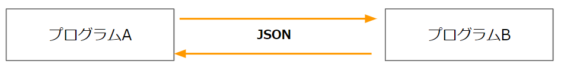
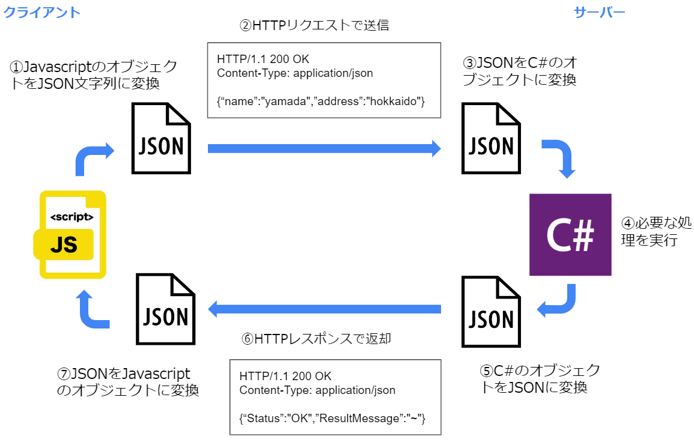

# JSONとは
JSONとは「JavaScript Object Notation」の略で、「JavaScriptのオブジェクトの書き方を元にした、テキスト・ベースのデータ交換フォーマット」のことです。  

クライアント・サーバー間など、異なる環境・言語間でデータをやり取りする際のフォーマットとしてよく利用されます。  

以下のように、JavaScriptでオブジェクトを定義するのと似た文法で記載します。 

JSON
```json
{"id" : "1", "name" : "suzuki"}
```  

JavaScript
```javascript
const obj = {id : "1", name : "suzuki"};
```  

JavaScriptとの主な違いは、プロパティ名もダブルクオーテーションで囲む事です。（その他の違いは下記の構文ルールを参照してください。）

## JSONの構文ルール
JSONはJavaScriptより書き方のルールが厳しく、以下のルールがあります。  
（守られていないと、受け取った側で解析エラーになります。）  

- 文字列とプロパティ名は、ダブルクオーテーション`"`で囲む（シングルクオーテーション`'`は使えない）
- 最後の要素の後ろにカンマを付けない（`[1, 2, 3,]`のような末尾カンマは不可）
- コメントは書けない
- 使える値は、文字列・数値・真偽値（`true`/`false`）・`null`・オブジェクト・配列のみ（関数や`undefined`は使えない）

配列やネストしたデータもJavaScriptと同じように表現できます。  
例  
```json
{
  "orderNo" : 100,
  "name": "yamada",
  "shipTo": { "name": "takeda", "address": "hokkaido" },
  "products": [
                  {"name": "shohin1", "count": 1},
                  {"name": "shohin2", "count": 2},
                  {"name": "shohin3", "count": 3}
              ]
}

```

JSONはシンプルなフォーマットの為、JavaScriptに限らず様々な言語で利用されています。    

## JSONの仕様
JSONの仕様はECMAとIETFという標準化団体により定義されています。  
仕様文書は以下となります。  
- ECMA: [ECMA-404](https://ecma-international.org/publications-and-standards/standards/ecma-404/)  
- IETF: RFC 8259 [原文](https://www.rfc-editor.org/rfc/rfc8259) / [日本語訳](https://www.asahi-net.or.jp/~ax2s-kmtn/internet/rfc8259j.html)  


## JSONの利用方法
異なる言語・環境で動作するプログラム間でデータをやりとりする際によく使われます。  
（クライアント・サーバー間など）  

  

異なる言語・環境で動作するプログラム間でやり取りされるデータは、お互いのプログラムが認識できるものでなくてはいけません。  
そこでよく利用されるのが文字列です。    
言語問わずほとんどのプログラムは文字列を認識できるので、送りたいデータを文字列に変換して送信し、受け取った側は文字列からデータを復元することでデータを受け渡せます。  

この際、文字列が何らかのルール（フォーマット）に沿っていないとプログラムが解析できません。  
そのフォーマットとしてよく利用されているのがJSONです。  
（以前はXMLというフォーマットがよく利用されていましたが、現在では文法がシンプルなJSONが利用されることが多いです。）  


### JSONを介したクライアント・サーバー間でのデータのやり取り
クライアントプログラム・サーバープログラム間でデータをやり取りする際にもJSONはよく利用されます。  
ここではクライアントのJavaScriptとサーバーのC#(ASP.NET Core)でデータをやり取りする際の例を説明します。  

処理の流れは以下になります。  

  

※図の②の1行目は、正しくは`POST /Home/Search HTTP/1.1`（リクエストライン）です。また、図中の引用符は正しくは半角の`"`です。  

1. （JavaScript）サーバーに送信したい値を持ったオブジェクトを作成し、JSON文字列に変換  
大半の言語には、オブジェクトをJSON文字列にしたり、JSON文字列からオブジェクトを作る為のライブラリが存在します。  
JavaScriptでは標準の関数として用意されています。  
（`JSON.stringify()`：オブジェクト→JSON文字列、`JSON.parse()`：JSON文字列→オブジェクト）  

1. （JavaScript）JSON文字列をリクエストボディに記載してサーバーに送信。  
  
1. （C#）リクエストボディからJSON文字列を取得し、C#のオブジェクトに変換  
C#側にもJSONを変換する為のクラスが存在します。  
JSONのプロパティと同名のメンバをもったクラスを定義しておき、それに変換します。   

1. （C#）そのオブジェクトを元に必要な処理を行う。   
DBへのSQLの発行など、必要に応じた処理を行います。  

1. （C#）クライアントに返却する値を持ったオブジェクトを作成し、JSON文字列に変換

1. （C#）JSON文字列をレスポンスボディに記載してクライアントに返却

1. （JavaScript）レスポンスのJSON文字列をJavaScriptのオブジェクトに変換  
（`fetch()`の場合は`response.json()`で変換できます。）

コードだと以下のようになります。  

- JavaScript側  
```javascript
const search = async () => {
        
    //サーバーに送信したい値を保持したオブジェクト
    const data = {name: "yamada",address: "hokkaido"};

    //Fetch API経由でサーバーにHTTPリクエストを送信
    const response = await fetch('/Home/Search', {
        method: 'POST',
        headers: {
          'content-type': 'application/json'
        },
        //オブジェクトをJSON文字列に変換してリクエストボディに設定
        body: JSON.stringify(data) 
    });

    //レスポンスボディのJSONをJavaScriptのオブジェクトに変換
    const result = await response.json(); 

    console.log(result.Status); //OK
    console.log(result.ResultMessage); //処理が成功しました。
}
```

- C#側  
```C#
public async Task<IActionResult> Search()
{
    //リクエストメッセージを表すクラスのインスタンスを取得
    HttpRequest request = HttpContext.Request;

    //リクエストボディからJSON文字列を取得
    //（ASP.NET Coreでは同期的な読み込みは既定で例外になるため、非同期で読み込む）
    string bodyString = await new StreamReader(request.Body).ReadToEndAsync();

    //JSONをC#のオブジェクトに変換
    MyParameter parameter = JsonSerializer.Deserialize<MyParameter>(bodyString);

    //色々な処理
    //クライアントに返却する値を持ったオブジェクト
    MyResult result = new MyResult("OK", "処理が成功しました。");

    //JavaScriptに返却する値をJSON文字列に変換
    string resultString = JsonSerializer.Serialize(result);

    //レスポンスボディにJSON文字列を書き込み
    HttpResponse response = HttpContext.Response;
    response.ContentType = "application/json";
    await response.WriteAsync(resultString);
    return new EmptyResult();
}

～以下のパラメータ用のクラスを定義しておく

 //HTTPリクエストのJSONの変換先
public class MyParameter
{
   public string name { get; set; }
   public string address { get; set; }
}

//HTTPレスポンスに書き込む内容を保持したオブジェクト
public class MyResult
{
    public MyResult() { }
    public MyResult(string status, string resultMessage)
    {
        Status = status;
        ResultMessage = resultMessage;
    }
    public string Status { get; set; }
    public string ResultMessage { get; set; }
}
```

※ 実際にはC#側でこの例のようなコードを記述することはほとんどありません。  
(JSONとの変換処理を自動的に行ってくれるフレームワークを利用する事が多いです。)  
処理がイメージしやすいようあえてこのように書いています。    


## 参考
[MDN JSON](https://developer.mozilla.org/ja/docs/Web/JavaScript/Reference/Global_Objects/JSON)
