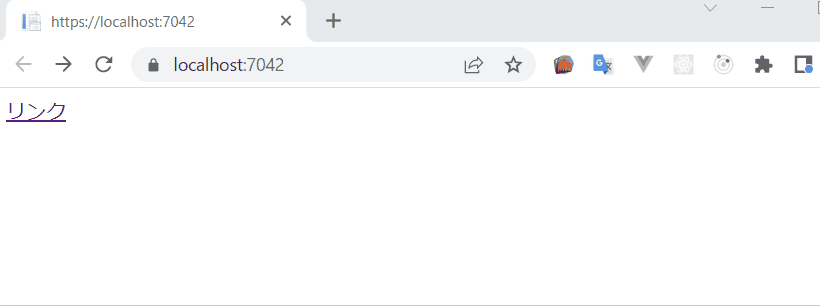
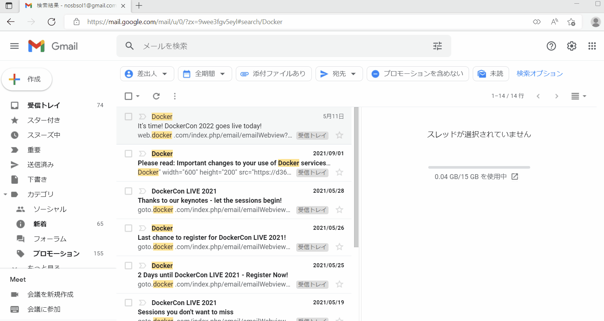
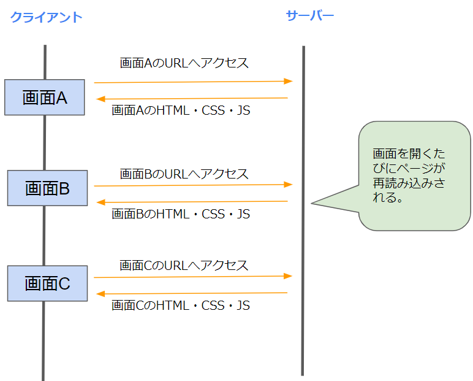
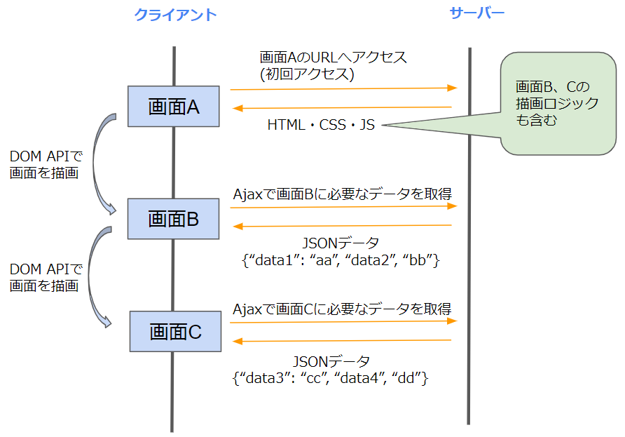
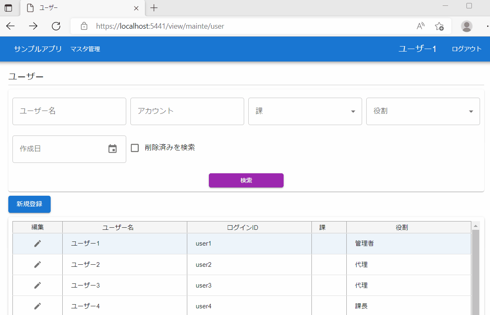

# SPA（シングルページアプリケーション）とは  


## よくある画面遷移 
Webサイトはページ上のリンクから他のページに遷移することが出来ます。  
例えばYahoo!ニュースでは、ニュース一覧のリンクをクリックすると、詳細なニュースページに遷移します。  

このようにリンクからページ遷移した場合、タブの横にロード中のマークが表示され、画面が一瞬止まったようになった後に画面が再描画されます。  
   
※この記事では以降、このような動作を**ページ全体の再読み込み**と呼ぶことにします。    

このような画面表示は一般的なものですが、画面全体の再描画を行う必要がある為、画面の表示に1秒程掛かる場合があります。  
そのため、頻発するとユーザーのストレスとなってしまいます。  


## SPA（シングルページアプリケーション） とは
これに対し、**画面遷移をJavaScriptで行い、必要なデータだけをAjaxで取得することで、ページ全体の再読み込みを極力無くしたWebサイトをSPAと呼びます。**    
（[Ajax](3_1.ブラウザがHTTP通信を行うタイミング.md#サーバーからの情報を取得し画面の一部を書き換える)とはJavaScriptでHTTPリクエストを発行し画面の一部を置き換える処理のことです。）  

例えば、ブラウザ版のOutlookやGmailはSPAといえます。  
メールをクリックすると、ページの再読み込み無しで右側のパネルにメールの本文が表示されます。  

 


### MPA（Multiple Page Application）
SPAの対義語は**MPA**（Multiple Page Application）と呼ばれます。  
(あまり使ってる人を見ないですが)  

最初に説明したYahoo!ニュースのようなサイトのことです。  

## SPAの特徴
SPAの特徴は、別画面への遷移もページ全体の再読み込み無しにJavaScriptで行い、必要なデータだけをAjaxで取得する事です。  
1枚のHTMLをもとに、JavaScriptで複数の画面を動的に作成していきます。 

MPAと比較した処理手順は以下になります。  

- MPA  
画面を遷移するたびにHTMLやJavaScriptなどのリソースを取得し、ページを再読み込みします。  
  

- SPA  
HTMLと他画面の描画ロジックも含むJavaScriptを最初に取得し、以降の画面遷移はJavaScriptのDOM APIで行います。  
必要なデータがあれば都度Ajax通信で取得します。  
  

※図中のJSONは、正しくは`{"data1": "aa", "data2": "bb"}`のように書きます（キーと値の間は`:`、引用符は半角の`"`）。  

SPAで読み込むJavaScriptには、DOM APIでHTML要素を作成するロジックが含まれていますが、表示するデータまでは含まれません。  
データは都度Ajax通信でサーバーから取得します。  

例えばマイページを描画する場合、画面描画のタイミングでログインユーザーの名前や住所などのデータをAjaxでサーバーから取得し、それをHTML要素作成ロジックに渡して画面を描画します。  

  

### 初回に読み込むHTML
SPAのHTMLは必要最小限の要素しか持ちません。  
最初に読み込まれるのは以下のようなHTMLになります。  
（JavaScriptの読み込むタグと、画面を表示する為のdivがあるだけのHTML）

```html
<!DOCTYPE html> 
<html lang="ja">
  <head>
    <meta charset="UTF-8">
  </head>
  <body>
     <div id="app"></div>

     <script src="/mySpa.js"></script>
  </body>
</html>
```

大半の要素はJavaScriptから動的に作成されます。  
JavaScriptには各画面を描画する処理が記述される為、ファイルサイズが大きくなりがちです。  

## SPAのメリット  
SPAにする主なメリットは以下になります。  

### 表示速度が速く、操作性が良い   
SPAを利用するメリットは、なにより表示速度が速くなりユーザーストレスが軽減することです。   
ページ上の必要な部分だけを更新するため軽快に動作させることができ、ネイティブアプリに近い表示・操作感を実現することができます。  

### サーバー側の処理が（比較的）シンプルになる  
サーバー側はJSPやRazorなどのテンプレートを使ってHTMLを作成する必要がなくなり、JSONなどでデータを返す処理に専念する形になります。  
そのため、サーバーサイドの処理がシンプルになります。  


## SPAのデメリット  
SPAにする主なデメリットは以下になります。  

### 初回読み込みの遅延  
JavaScriptに各画面を描画する処理が含まれるため、JavaScriptのファイルサイズが大きくなります。  
その為、JavaScriptが取得される、最初の画面表示時に従来より時間が掛かってしまいます。   
（たとえばトップページを開く際に、検索ページやマイページを描画するロジックを含んだJavaScriptを読み込むことになります。）  

読み込み速度を速くするために、JavaScriptファイルの圧縮やキャッシュの利用などの工夫をする必要があります。    
また、JavaScriptを画面ごとなどに分割し（コード分割）、必要になったタイミングで読み込む（遅延読み込み）ことで、最初に読み込む量を減らす方法もよく使われます。  

### クライアント側の処理が複雑になる
クライアント側で動的に画面を生成するため、クライアント側の処理が複雑になります。  
素のJavaScriptだけでコーディングするのは大変な為、後述するReactなどのライブラリを使って実装していくことが多いです。  

### 戻る・進む履歴、ページリフレッシュへの対応
DOM APIでページを切り替えてもブラウザの戻る・進む履歴には表示されません。  
Ajax通信でサーバーにHTTPリクエストを送信しても同様に履歴には表示されません。  
そのため、そのままだとブラウザの戻る・進む機能が使えないサイトになってしまいます。  

また画面がリフレッシュされた場合、保持しているJavaScriptの変数が初期化されてしまいます。  
その場合でも画面を表示できるよう、リフレッシュ時に再度サーバーからデータを取得する処理を実装する必要があります。  

このような戻る・進む、ページリフレッシュへの対応を行う必要がある為、クライアント側の処理に工数が掛かってしまいます。  

#### 対応方法
対応する場合、JavaScriptのHistory APIというWeb APIを利用します。  
History APIを利用するとページの再読み込み無しでブラウザのURL欄を変更でき、変更前のURLは戻る履歴に追加されます。  
またHistory APIで追加したURLを戻る・進む履歴から開いた際は、ページの再読み込みは発生しません。  

これを利用し以下のような処理を実装します。

1. 画面遷移時にHistory API（`history.pushState()`）でURLを変更し、画面を描画する。その際必要なデータを取得する為のパラメータ（開いているメールのidなど）をURLに含んでおく。  
1. 戻る・進む操作時に発生する`popstate`イベントで、URLのパラメータをもとにサーバーからデータを取得し、画面を描画する処理を実行。  
（`popstate`イベントは主に戻る・進む操作で発生し、`pushState()`でURLを変更しただけでは発生しません。）  
1. ページ読み込み時（リフレッシュやURLを直接開いた場合）も、URLのパラメータをもとにデータを取得し、画面を描画する。  

なお、History APIで作った`/mail/123`のようなURLはJavaScriptが作り出したものなので、サーバー上にそのパスのファイルは存在しません。  
そのため、どのパスにリクエストが来ても最初のHTML（`index.html`など）を返すよう、Webサーバー側の設定（フォールバック）も必要です。  
（設定しないと、リフレッシュ時やURLを直接開いた際に404エラーになります。）  

実装時はこのような処理を行うためのライブラリを利用する事が多いです。  
（react-routerなど）
  
### 検索エンジン最適化 (SEO)
上述した通り、SPAで読み込まれるHTMLファイルにはほぼ何も記述されません。  
GoogleのクローラはJavaScriptを実行して内容を読み取れますが、JavaScriptを実行しないクローラや、SNSでURLを共有した際のプレビュー表示などでは、内容が空のページに見えてしまいます。  
（Googleでも、JavaScriptの実行が必要な分、内容の反映に時間が掛かる場合があります。）  

一般向けのサイト（企業のホームページなど）ではこれが問題になる場合があります。  
社内で使う業務アプリのように、そもそも検索エンジンに表示される必要がないサイトの場合は気にする必要はありません。  

通常のSPAは、ブラウザのJavaScriptでHTMLを作成する**CSR（クライアントサイドレンダリング）**という方式で、これがSEOの問題の原因になります。  
これに対応するための技術として、以下のようなものがあります。  
- SSR（サーバーサイドレンダリング）：リクエストのたびにサーバー側でHTMLを作成して返す  
- SSG（静的サイト生成）：ビルド時にあらかじめHTMLを作成しておく  

SSR・SSGでは最初から内容の入ったHTMLを返し、その後はSPAとして動作させることができます。  
ReactならNext.js、Vue.jsならNuxtといったフレームワークを使って実現することが多いです。  


## SPAの実装方法
SPAを実装する為のライブラリ・フレームワークを利用する事が多いです。  
代表的なものは以下になります。  

### React
Meta（旧Facebook）が主体で開発しているライブラリです。  
コンポーネントを組み合わせることで画面を構築していきます。  
世界的にシェアが高いです。  

### Vue.js
Reactと同じくコンポーネントを組み合わせることで画面を構築していきます。  
日本でのシェアが高いです。  

### Angular
Googleが中心となって開発しているフレームワークです。  
前身のAngularJSは3つの中で最も古くからあります。  
他2つに比べるとシェアは高くありません。  

## 参考

[MDN SPA](https://developer.mozilla.org/ja/docs/Glossary/SPA)

